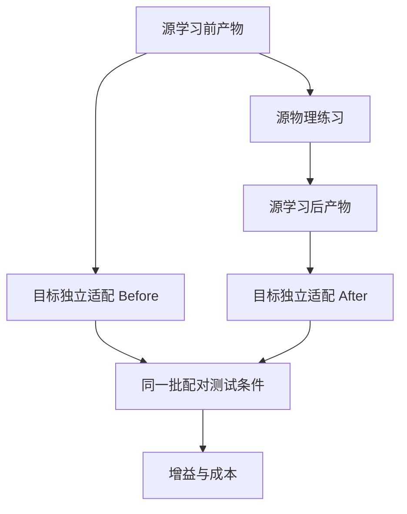

# PhysicalEvoBench-X：项目背景与 Codex 实施任务书

**版本：实施规格 v0.1；调研日期：2026-10-20 UTC / 2026-10-21 北京时间。**

**拟建仓库：`ros-claw/PhysicalEvoBench-X`。Python 包：`physicalevobench_x`。命令：`pebx`。**

本文供本地 Codex 直接执行。这里的 `pebx` 命令、模块、配置和数据结构是需要实现的项目接口，不是已经存在的 Arena 命令。源码核查已完成；GPU 仿真、物理标定、实验结果尚未执行。所有建议阈值和开发范围均须经过本文规定的开发集检查，再冻结为正式版本。

## 0. 给实施者的首要要求

完成一个独立、可复现的闭环：**机器人 A 练习 → 生成经验产物 → 冻结产物 → 机器人 B 使用 → 与 A 学习前的产物做配对比较**。同时实现反向 B→A。

先实现能真正运行的双夹爪稳定抬升任务、固定控制器和随机搜索基线，再接入只输出有界 JSON 的 LLM 提案器。不要将“有很多文件”“生成了技能描述”或“录到一次成功视频”视为完成。

本仓库独立于 `ros-claw/PhysicalEvoBench`，不等待旧项目完成，也不将旧项目作为运行依赖。ROSClaw 可以作为后续参赛系统；基准本身不能依赖 ROSClaw 才能运行。

**工程验收允许正迁移、零迁移、负迁移和没有发生有效源更新。工程验收不以任何方法胜出为条件。**

---

## 1. 项目背景：为什么值得做，具体测什么

### 1.1 核心问题

机器人系统的可扩展性，不仅取决于一台机器能够完成多少任务，也取决于一台机器积累的经验能否降低其他机器的试错成本。跨本体学习已有丰富先行工作；本项目需要将“源端新获得的经验”与已有基础能力、目标端适配、人工控制器工程分别记账。

PhysicalEvoBench-X 的核心问题是：

> 在基础执行器、本体适配层和目标交互预算相同的条件下，A 本轮物理交互中新获得的经验，使 B 的表现发生了多大变化？这个收益来自哪里，花费多少，何时会失效？

这里的“新经验”可以最终扩展为参数、条件规则、执行程序、失败记忆或模型权重；v0.1 只研究有界物理参数，先建立可信的测量流程。

### 1.2 相关工作与本项目位置

| 先行工作 | 已经研究的内容 | 对本项目的启示 |
|---|---|---|
| Open X-Embodiment / RT-X | 多机器人数据和跨机器人训练 | 不能声称首次让机器人共享经验；本项目单独测量新增经验的边际效果。[R1] |
| AnyBody | 多形态机器人控制与新形态泛化 | 形态泛化已有专门基准；本项目需要明确本体变化的具体维度。[R2] |
| ZETA | 受控的跨本体 VLA 迁移，区分目标本体暴露和变化类型 | “零样本”必须说明零的是哪种数据或交互；控制器、夹爪、预训练暴露都应记录。[R3] |
| BARX / RoboCasa-X | 行为对齐表示与跨本体迁移 | 经验的表示可能影响迁移，但表示比较必须匹配来源数据和目标预算。[R4] |
| EmbodiedEvo | 物理反馈驱动的经验更新，以及冻结后的复用 | 本项目应测源更新前后，而不只比较一个最终系统和一个弱基线。[R5] |
| Silicon Language | 异构机器人知识交换框架和部署案例 | 交换格式本身不等于迁移效果；需要受控、可重复的有效性评估。[R6] |

因此，本项目不以“换到 Isaac 平台”或“给技能一个 JSON 格式”作为研究创新。更有价值的贡献是：**可审计的跨本体新增经验协议、严格预算、物理一致的接口、迁移与负迁移证据，以及持续继承的后续扩展。**

### 1.3 v0.1 可以支持的结论

首版用同一 Franka 机械臂的 Panda Hand 与 Robotiq 2F-85 两种配置，测量末端执行器变化下的参数经验迁移。它是“近本体迁移”试验，不支持不同机械臂拓扑、任意形态或人形机器人间泛化的结论。

五维参数变化属于可复用的控制经验，但仍比条件技能和执行程序简单。只有后续加入条件规则、多任务、不同机械臂和多轮继承，才讨论更强的“跨本体持续进化”。项目名保留 Evolution，版本说明必须如实标注已达到的阶段。

建议 README 副标题：

> Measuring whether newly acquired robot experience improves another embodiment under matched adaptation budgets.

中文：**在相同适配预算下，测量一台机器人的新增经验能否改善另一台机器人的表现。**

---

## 2. 首版范围与后续阶段

| 项目 | v0.1 固定范围 |
|---|---|
| 仿真 | Isaac Lab-Arena 固定提交；PhysX；Linux x86_64 |
| 本体 A | `franka_ik`，Franka + Panda Hand |
| 本体 B | `droid_differential_ik`，Franka + Robotiq 2F-85 |
| 任务 | 本项目新增 `PEBX-StableLift-v0`：抓起并稳定保持 |
| 观察 | 状态与已知几何；明确为 state-based / privileged-geometry track |
| 执行 | 一套固定状态机 + 轨迹生成器；两种冻结的本体适配器 |
| 可更新内容 | 五维 `SkillSpec` 参数 |
| 提案器 | `random_search_v1`；`bounded_llm_v1` |
| 基础模型 | 权重冻结；仅回合之间生成参数候选 |
| 源预算 | 每次完整源学习 20 个物理回合，包含验证 |
| 目标预算 | 0、5、20；各预算独立启动 |
| 主比较 | SourceBefore 与 SourceAfter；与 TargetOnly 等价时合并 |
| 重复 | 双向迁移；3 个独立完整学习种子包作为 pilot |
| 评测 | 每格 50 个配对目标条件，冻结后评测 |

v0.1 不需要训练 VLA、不需要重训 RL、不需要 ROS 2 bridge、不需要技能市场或多 Agent 集群，也不需要先开发排行榜网站。保留清晰的接口，避免为尚无实验需求的功能建立框架。

扩展顺序：

1. **v0.1：参数经验。** 完成本文全部工程关卡与双向 pilot。
2. **v0.2：条件技能。** 加入受限条件规则、相同经验的不同表示对照、无反馈提案控制，以及至少一种不同任务机制。
3. **v0.3：不同运动学。** 新增另一机械臂家族；拆分“只换夹爪”和“只换手臂”的消融。
4. **v1.0：持续继承。** A→B→C 的多轮传递、旧技能保持、累计成本和经验适用性判断。

---

## 3. 已核实的技术底座与必须冻结的版本

### 3.1 固定到提交，不跟随 `main`

本次源码核查确认以下组合：[S1–S4]

```yaml
audit_date_utc: "2026-10-20"
arena:
  repository: "https://github.com/isaac-sim/IsaacLab-Arena.git"
  reference_branch_at_audit: "release/0.3.1"
  commit: "c7edf3a9d5d8276565208f72422f8f8a0806d6cf"
isaac_lab:
  repository: "https://github.com/isaac-sim/IsaacLab.git"
  commit: "91a0906f93802eb859192dcb0bca879f891e92d6"
isaac_sim:
  image_tag: "nvcr.io/nvidia/isaac-sim:6.1.0"
  image_digest: null
python:
  required: ">=3.12,<3.13"
physics:
  backend: "physx"
  physics_dt_s: 0.005
  decimation: 4
  control_dt_s: 0.02
```

`image_digest: null` 只允许出现在初始实施模板，正式实验前必须通过本地实际拉取补齐；不能凭空编造 digest。驱动版本、CUDA/Torch 版本、CPU/GPU、资产来源和缓存内容校验和也写入最终 lock 与运行 manifest。

固定提交的 `pyproject.toml` 仍写包版本 `0.3.0`；不能用包版本字符串推断正在运行 `release/0.3.1`。部分文档和 `main` 的接口与该提交不一致。以提交下的源码、Dockerfile、子模块和已验证安装为依据，不混用其他分支的示例。

采用 Arena 的未修改 git submodule。项目扩展放在本仓库包内。上游确有 bug 时先建立最小复现；需要补丁就显式记录补丁 hash 和原因，所有实验组用同一补丁，不能静默改动上游评分逻辑。

### 3.2 机器分工

优先在 RTX A6000 的 Linux x86_64 机器上完成 Isaac Sim/Arena smoke test；用实际兼容性检查确认驱动和当前版本能启动，不能只看显存。官方要求说明无 RT Cores 的 A100/H100 不受支持，因此不要把 H800 集群默认当作 Isaac Sim RTX 工作站。H800 可优先承担已验证的模型推理服务。[S19]

DGX Spark 是另一套平台验证任务；首版先固定一台可复现的 x86_64 RTX 环境，不同时维护不同架构安装方案。首版 `num_envs=1`，关闭算法不需要的相机；在 reset、材料隔离与配对条件验证通过后再做并行。

### 3.3 源码中的关键事实

| 事项 | 已核实事实 | 实施影响 |
|---|---|---|
| 环境工厂 | `ArenaEnvironmentFactory[ConcreteCfg].build(cfg)` 与 `@register_environment` 已存在 | 新项目采用 typed factory，不照抄旧 `get_env` 教程。[S5] |
| 环境构建 | `ArenaEnvBuilder(...).make_registered_and_return_cfg()` 返回真正 gym env 和 cfg | factory 的 `build()` 结果不是最终可直接 `step()` 的 gym env。[S6] |
| 启动顺序 | 官方 runner 进入 `SimulationAppContext` 后才导入、注册、构建仿真环境 | CPU 命令不能在包导入时启动 Isaac；按官方 runner 的顺序组织。[S7] |
| 两种 IK 本体 | `franka_ik` 和 `droid_differential_ik` 均存在 | 无需从 joint-position 本体重新发明 DROID IK。[S8,S9] |
| 默认频率 | Arena 默认配置不是 50 Hz | 显式调用 `set_control_rate_50hz` 并启动后核实 `physics_dt=.005`、`step_dt=.02`。[S10] |
| 物体状态 | `ArenaWorld.get_pose_w` 为 xyz + xyzw | 统一坐标及四元数约定；不要相信个别旧 docstring。[S11] |
| 夹爪 | 两种默认配置均为 binary open/close | 首版不开放“连续开度”或“抓力”学习参数。[S8,S9,S12] |
| 现成接触判定 | PickAndPlace 中的 filtered contact 是 object→destination | 它不等于“双指抓住物体”的传感器。[S16] |
| 物体资产 | 官方 `procedural_cube` 并非可任意传 size 的 5 cm 立方体 | 自建明确尺寸的程序刚体，先保证两个夹爪可抓。[S17] |

---

## 4. 仓库创建与安装落实

### 4.1 仓库状态与创建方式

本次连接查询可访问到 `ros-claw/PhysicalEvoBench`，未找到可访问的 `ros-claw/PhysicalEvoBench-X`。本次调研没有创建远程仓库。

本地 Codex 先检查组织授权和目标仓库是否存在。只有明确确认不存在时才创建；不能把网络错误、鉴权失败或临时超时当成不存在。GitHub CLI 官方支持以下创建形式：[S20]

```bash
gh auth status
gh repo view ros-claw/PhysicalEvoBench-X --json nameWithOwner,url,defaultBranchRef
```

若确认尚未创建：

```bash
gh repo create ros-claw/PhysicalEvoBench-X \
  --public \
  --description "A benchmark for cross-embodiment experience transfer and continual improvement." \
  --add-readme \
  --gitignore Python \
  --license apache-2.0 \
  --clone
```

若已存在，则 clone 该仓库；不要创建 `PhysicalEvoBench-X-2`，也不要覆盖已有工作。进入仓库后建立自己的实现分支，提交应按阶段可审查。

代码建议 Apache-2.0。资产、模型权重、第三方代码的许可单独记录在 `THIRD_PARTY_NOTICES.md` 与资产清单中，不把仓库许可证自动套用到外部资产。

### 4.2 固定 Arena 子模块

下面是在仓库根目录、子模块尚未存在时执行的真实 Git 命令：

```bash
git submodule add https://github.com/isaac-sim/IsaacLab-Arena.git third_party/IsaacLab-Arena
git -C third_party/IsaacLab-Arena checkout c7edf3a9d5d8276565208f72422f8f8a0806d6cf
git -C third_party/IsaacLab-Arena submodule update --init --recursive
git -C third_party/IsaacLab-Arena rev-parse HEAD
git -C third_party/IsaacLab-Arena/submodules/IsaacLab rev-parse HEAD
```

后续复现者使用 `git clone --recurse-submodules` 或 `git submodule update --init --recursive`。不要给正式配置写 `arena: latest`。

### 4.3 安装策略与 Docker 边界

优先复用固定提交的官方 Dockerfile 和安装脚本，先让原生 Arena 环境启动，再安装本包。固定版本官方 Dockerfile 使用 Isaac Sim 的解释器安装 Arena：

```bash
/isaac-sim/python.sh -m pip install --no-deps --no-build-isolation -e /workspaces/isaaclab_arena
```

该命令只说明官方容器中的安装方式；不是把宿主机任意 Python 环境变成 Isaac Sim 的通用命令。[S2]

在固定 Arena checkout 内，已核实官方脚本接受 `./docker/build_docker.sh -t dev` 与 `./docker/run_docker.sh -t dev`；本次没有实际构建或运行。build 脚本会刷新 base image，必须记录实际 digest。新项目的运行封装需先解决下述外层仓库挂载问题，再将这些命令纳入可复现流程。[S22]

本仓库需提供自己的 `docker/Dockerfile`、`scripts/build_container.sh`、`scripts/run_container.sh`：基于已验证 Arena 镜像，把整个 PhysicalEvoBench-X 仓库安装或挂载到固定目录，同时保留 Arena 可导入路径。上游 `docker/run_docker.sh` 的挂载只覆盖 Arena checkout，不能假设它自动看到外层新仓库。

实施时核实当前脚本真实参数和构建 target，再把**实际成功的命令**写进 README。不要凭印象编造 `isaaclab_arena --run`、`arena launch` 等命令。基础镜像需遵守 NVIDIA 的下载与许可流程；在本机已有授权的环境中使用。

CPU-only 开发环境只安装本项目 schemas、协议、报告和测试依赖；不导入 `omni`、Isaac 或启动 GPU。使用明确的 `sim` / `llm` optional dependencies，锁定本地验证后的 Python 依赖，不在全局环境执行不受控升级。

---

## 5. 项目结构与职责

以下为建议最终目录结构；按阶段创建，不要先生成大量空壳。

```text
PhysicalEvoBench-X/
  README.md
  README.zh-CN.md
  AGENTS.md
  LICENSE
  THIRD_PARTY_NOTICES.md
  pyproject.toml
  dependencies.lock.yaml
  docs/
    background.md
    protocol_v0.1.md
    implementation_plan.md
    upstream_audit.md
    reproduction.md
    limitations.md
  configs/
    tasks/stable_lift_dev.yaml
    tasks/stable_lift_v0.yaml
    embodiments/franka_panda.yaml
    embodiments/franka_robotiq.yaml
    learners/random_search.yaml
    learners/bounded_llm.yaml
    experiments/smoke.yaml
    experiments/pilot.yaml
  schemas/
    skillspec.schema.json
    observation.schema.json
    feedback.schema.json
    run_manifest.schema.json
    episode_result.schema.json
  src/physicalevobench_x/
    cli.py
    core/
      schemas.py
      hashing.py
      budget.py
      conditions.py
      selection.py
      aliasing.py
    sim/
      launch.py
      arena_factory.py
      assets.py
      stable_lift_task.py
      state_reader.py
      conditions_applier.py
      embodiments.py
    control/
      canonical.py
      franka_adapter.py
      droid_adapter.py
      trajectory.py
      grasp_lift_executor.py
    learners/
      base.py
      random_search.py
      bounded_llm.py
      prompts/parameter_proposal_v1.txt
    protocol/
      source_acquisition.py
      target_adaptation.py
      evaluation.py
      orchestration.py
      reconstruct.py
    reporting/
      aggregate.py
      plots.py
      report.py
  tests/
    unit/
    protocol/
    sim/
  scripts/
    build_container.sh
    run_container.sh
  docker/Dockerfile
  third_party/IsaacLab-Arena/
  examples/skills/initial_v1.json
  .github/workflows/ci.yml
```

`runs/`、视频、模型缓存、资产缓存、私有 test manifest 和 `.env` 默认不进 Git。可发布小型真实示例和结果摘要，但不能用伪造数据冒充实验产物。

### 5.1 数据与权限边界

| 组件 | 能读取 | 能修改 |
|---|---|---|
| 可信仿真 worker | 全部物理状态、私有条件、冻结控制器 | reset 时施加条件；运行中只执行合法控制命令 |
| 固定 executor | 明确公开的 ObservationFrame、当前 SkillSpec | 自身回合内状态与 canonical action |
| learner / proposer | 参数边界、初始 SkillSpec、训练历史与公开反馈 | 有界参数候选 JSON |
| evaluator | 完整状态与私有成功规则 | 评测计时器、结果记录 |
| reporter | 冻结后结果与成本账本 | 派生统计与图表 |

LLM 不直接拿到 `env`、`arena_world`、USD stage、文件系统根目录或 Python 执行接口。Arena 原生 policy 可能接受 `env`；本项目的模型进程必须通过自有 allowlist 接口隔离这个权限。

### 5.2 建议接口

以下是本项目需要实现的接口示意，不声称为上游 API：

```python
class SkillProposer(Protocol):
    def propose(self, request: ProposalRequest) -> SkillSpec: ...

class FixedExecutor(Protocol):
    def reset(self, skill: SkillSpec, initial: ObservationFrame) -> None: ...
    def step(self, obs: ObservationFrame) -> CanonicalCommand: ...

class EmbodimentAdapter(Protocol):
    def read_state(self) -> ObservationFrame: ...
    def encode(self, cmd: CanonicalCommand) -> NativeAction: ...

class EpisodeRunner(Protocol):
    def run(self, request: EpisodeRequest) -> EpisodeResult: ...
```

真实 GPU runner 与 CPU fake runner 使用同一个 `EpisodeRunner` 协议，但结果必须写 `backend=physx` 或 `backend=fake`。报告命令拒绝把 fake 结果纳入物理性能表。

`CanonicalCommand` 的语义固定为：**世界坐标系绝对 TCP 目标位姿 `position_m[3] + quaternion_xyzw[4]`，加 `OPEN/CLOSE` 枚举。** 轨迹生成器使用 `step_dt` 将速度/加速度约束积分为下一步目标 pose；adapter 再求原生 control 点相对当前状态的位姿增量，并除以原生 scale。已计算出的 pose delta 不再次乘 `dt`。所有限幅的位置、单位和顺序固定。

---

## 6. 任务定义：PEBX-StableLift-v0

### 6.1 共同物理场景

新增一个明确尺寸、质量、惯性和碰撞形状的程序 cuboid，放在静态桌面上。夹爪与物体的抓取宽度必须兼容。任务可使用静态固定机械臂基座；物体必须是自由刚体，不能加入吸附、焊接或跟随末端位姿的约束。

第一轮开发建议：物体约 `0.045 × 0.045 × 0.065 m`；名义质量 `0.20 kg`；抓取姿态向下，抓取轴固定对应物体的一条水平边。桌面、机器人安装位姿与初始关节角由开发标定固定，必须保存成配置。不要将未经验证的世界坐标直接当作两个模型都可达的共同工作区。

按以下顺序确定任务分布：

1. 两种本体各自在名义条件下完成真实抓取和稳定保持。
2. 验证共同可达区域、夹爪容纳宽度、初始无穿透与动力学稳定。
3. 只在开发集上尝试小范围位置、yaw 和质量变化；先固定摩擦与质心。
4. 采用一个公开、共同、可执行的参考控制方案验证难度；不能挑选只对某个 learner 有利的条件。
5. 冻结分布、成功判定、控制器、适配器和参数边界，生成独立 train/validation/test 条件。

质量候选开发范围可从 `0.10–0.50 kg` 开始；水平偏移可从名义位置附近 ±`0.03 m`、yaw ±`10°` 开始。**这些是待验证的开发起点，不是已证明有区分度的正式范围。** 如果共同控制器在整个可行范围内已饱和成功，保留这个结论；不能为让某方法获胜故意削弱初始策略。必要时以新 task version 引入更有物理意义的扰动，重新冻结协议。

质量变化要真实写入物理后端，且保持对应惯性一致；材料参数要真实作用于碰撞对象。核对后端读回值，用受控力/冲量响应验证质量差别；不能用理想自由落体速度区分质量。摩擦变化后续用滑移试验验证，不能只改 metadata。

先 `num_envs=1`，防止材料共享和 cloned prim 状态串扰。并行化前必须证明一个 environment 的质量、摩擦、reset 不影响另一个。

程序 cuboid 的尺寸与 bounding geometry 使用项目自有解析几何，不调用要求 USD 路径的默认 `get_bounding_box/get_corners` helper。首版由 manifest 接管 placement；显式配置 relation/randomization 路径，防止 reset 后重新覆盖物体位姿。需要接管 object reset 时可使用真实公共方法 `Object.disable_reset_pose()` 并接入自有 reset event。条件在 reset 阶段的确定位置施加，随后 settle、读回实际状态并核对 manifest，最后启用 executor。[S16,S23]

### 6.2 成功规则

第一版成功要求连续满足以下条件：

1. 物体相对本回合 settle 后的初始中心高度上升至少 `0.08 m`。
2. 物体与 TCP 的相对位姿在保持窗口中稳定，没有明显滑脱。
3. 物体线速度与角速度在冻结阈值内，避免抛掷越过高度线被算作成功。
4. 满足以上条件的连续模拟时间达到 `1.0 s`。
5. 没有任务规定的硬约束违反；物体没有离开工作区或被静态结构托住冒充抓取。

建议开发阈值为：相对位置窗口漂移 ≤`0.015 m`、相对旋转漂移 ≤`15°`、物体线速度 ≤`0.03 m/s`、角速度 ≤`0.5 rad/s`。这些值在开发校验后作为 `task_definition_hash` 的组成部分冻结。静态支撑排除至少由几何净空验证；需要接触传感增强时按第 7 节验证。

计时用模拟时间戳，记录第一个 qualifying sample 的 `t_start`，只有 `t_now - t_start >= 1.0` 才成功；中途任一条件不满足则清零。50 Hz 下首尾跨度 1 秒通常需要 51 个连续采样，不能把 50 个时间点的 0.98 秒跨度写成 1 秒。

最大执行时间定为 `15 s`，环境 reset 后先 settle `0.5 s` 再设置 `z0` 和开始执行计时。Arena 总 episode timeout 为 `15.5 s`，`episode_sim_time` 与 `execution_time` 分开记录；初始化阶段不启用成功保持计时器。超过执行时间记任务失败；成功后立即终止。达到截止时刻的成功与硬失败同时出现时，硬失败优先。terminal evidence 在 Arena pre-reset recorder 阶段复制保存，不能等 `env.step()` 返回后再读取可能已被重置的 world 状态。[S21,S23]

保持稳定的判据由 evaluator 实现，executor 不能调用 `is_success` 或 `is_grasped` oracle。executor 使用公开几何状态自行闭环；训练回合结束后 learner 可以获得协议规定的成功/失败反馈。

`StableLiftTask` 完整实现 `TaskBase` 的五个抽象方法：`get_scene_cfg`、`get_termination_cfg`、`get_events_cfg`、`get_mimic_env_cfg(arm_mode)`、`get_metrics`。首版冻结 `mimic=False`；Mimic 方法仍须显式实现并在误调用时给出不支持错误。权威成功判定接入 `TaskTerminationCfg` 的 `CompletionCriteria`，硬失败也从同一状态派生，保证 Gym termination、训练反馈、Arena metrics 与报告一致；不能在 rollout 后另写一套与环境不同的成功规则。[S21]

没有经过验证的双指接触检测时，主结论仅为“稳定抬升成功”，不宣称已经认证某种具体接触拓扑。几何净空、自由刚体约束、轨迹与失败视频共同用于检查评分漏洞。

### 6.3 失败类型

至少区分 `APPROACH_TIMEOUT`、`GRASP_MISS`、`SLIP_DURING_LIFT`、`HOLD_UNSTABLE`、`OBJECT_OUT_OF_BOUNDS`、`JOINT_OR_WORKSPACE_LIMIT`、`TIME_LIMIT`。这些标签须来自实际可观测的规则，不得把隐藏质量/摩擦真值作为模型可见的失败原因。

基础设施错误单列，如 `SIM_START_FAILURE`、`ASSET_LOAD_FAILURE`、`INVALID_RESET`、`SENSOR_SCHEMA_ERROR`。不能把这些错误统一记成技能失败，也不能悄悄从分母删除。

---

## 7. 本体适配：首先排除坐标与动作错误

### 7.1 两种原生配置的差异

| 项目 | Franka Panda | Franka + Robotiq / DROID |
|---|---|---|
| Arena registry name | `franka_ik` | `droid_differential_ik` |
| 原生控制 body | `panda_hand` | Robotiq `base_link` |
| IK 控制点 offset | hand 局部 z +`0.107 m` | base_link 原点 |
| IK 方式 | relative pose、DLS | relative pose、DLS |
| 原生动作 scale | `0.5` | `0.5` |
| 原生 float CLOSE | `-1.0` | `1.0` |
| 原生 float OPEN | `1.0` | `0.0` |
| 典型名义 TCP | 观测 frame z +`0.1034 m` | 开夹时 base_link 局部 x +`0.131 m` |

以上来自固定提交和固定 Lab 的动作实现。[S8,S9,S12,S13] 原生夹爪 float 语义不同，所以 canonical action 只用 `OPEN/CLOSE` 枚举，由适配器编码；不要用含糊的 float 透传或直接复用两台机器的 7 维动作向量。

### 7.2 Canonical TCP 与完整变换

统一 canonical TCP 的位置定义为两指 pad frame 的中点：

\[
p^W_{TCP}(t)=\frac{p^W_{left}(t)+p^W_{right}(t)}{2}.
\]

姿态使用控制 body 姿态乘以固定、经过标定的轴变换，统一接近轴与夹闭轴。两点本身不足以唯一确定完整旋转。两本体使用同一种测量约定，不能一个用 hand origin、另一个用指尖。

DROID 的 `.131 m` 是开夹时的名义参考；闭夹过程中抓取中心会移动。冻结的是测量函数与轴定义，不是把这个数永久加到世界 x 坐标。控制点到当前 measured TCP 的变换由可信 adapter 更新。

给定世界系期望 TCP pose，计算：

\[
T^W_{control,des}=T^W_{TCP,des}\left(T^{control}_{TCP}\right)^{-1}.
\]

然后转到原生 IK 所需的 robot root frame，计算相对位移/轴角增量，并正确处理原生 `scale=0.5`、控制步长、限幅和 quaternion `xyzw`。Panda 的 action body offset 也属于控制点定义的一部分，不能再重复加一次。[S13]

几何 midpoint 是仿真几何代理，不宣称为真实接触中心。完整 TCP mapping、原生 term 顺序、轴变换、读状态方法和标定数据均计算 hash，在所有组间冻结。

### 7.3 已存在的可用状态接口

固定版本中已核实：[S11,S14]

```python
world.get_pose_w(object_name)
world.get_pose_e(object_name)
world.get_root_linear_velocity_w(object_name)
world.get_root_angular_velocity_w(object_name)
world.get_body_pose_w("robot", body_name)
world.get_frame_position_w("ee_frame", frame_name)
embodiment.get_gripper().get_opening_width_m(world)
```

没有核实到 `world.get_frame_pose_w()`，不要凭命名习惯杜撰这个接口。DROID 某些原生 `eef_pos` 对应 base_link，归一化 `gripper_pos` 不是米；使用公共 world / gripper 接口并做运行验证。

### 7.4 必须通过的适配测试

每个本体分别完成：

- OPEN/CLOSE 后的真实关节与米制开度变化，不能只检查动作张量。
- 小幅 world +x/+y/+z 位移，实测 TCP 方向与幅度；旋转时 offset 随旋转变化。
- TCP→control→TCP 变换往返误差与 quaternion 轴向检查。
- 原生 root frame、environment origin 与 world frame 的转换正确。
- 相同 canonical 速度/加速度在两本体上单位一致；记录请求值与实际轨迹。
- 对象与 TCP 没有写错 actor 索引；episode reset 后无上回合缓存残留。

建议把静态坐标变换数值误差和物理跟踪误差分别报告：前者应接近浮点精度，后者按开发校准的毫米/角度容差验收，不能用一个大阈值掩盖坐标错误。

### 7.5 Contact 只在验证后启用

v0.1 必需输入中不包含接触力。使用 public state、实际 jaw gap 和相对运动即可完成首版。

后续启用双指—物体 filtered contact 时，先核实实际 rigid body paths、数据字段与 backend。固定 Lab 的 filtered sensor 对每个 environment 的 sensing prim 有单 body 约束，数据字段为 `normal_force_matrix_w`。程序生成 cuboid 不能直接依赖要求 `usd_path` 的 Arena object helper；需显式构造 sensor，并正确启用 contact reporting。[S15,S16]

用空夹、单指碰物、双指夹物、手指碰桌四类场景检验过滤结果。未经这些验证，不能把任意接触数值或夹爪 closing error 命名为“抓力”。

---

## 8. SkillSpec：五维可执行参数，而非自由代码

### 8.1 首版字段

```yaml
schema_version: "physicalevobench_x.skillspec.v1"
controller_family: "grasp_lift_state_v1"
parameters:
  grasp_height_fraction: 0.50
  pregrasp_clearance_m: 0.07
  settle_time_s: 0.30
  lift_vmax_mps: 0.10
  lift_amax_mps2: 0.30
requirements:
  end_effector: "parallel_jaw"
  action_interface: "cartesian_pose_and_binary_gripper"
```

| 字段 | 物理解释 | 初始开发边界 |
|---|---|---|
| `grasp_height_fraction` | 物体底面到顶面之间的相对抓取高度 | 0.25–0.75 |
| `pregrasp_clearance_m` | 预抓取点相对抓取点沿接近轴的净空 | 0.04–0.12 m |
| `settle_time_s` | 闭夹后、抬升前的等待时间 | 0.10–0.80 s |
| `lift_vmax_mps` | 抬升轨迹最大线速度 | 0.03–0.20 m/s |
| `lift_amax_mps2` | 抬升轨迹最大线加速度 | 0.10–0.80 m/s² |

这些边界须与任务范围一起经过开发可行性验证并冻结。v0.1 不允许 learner 修改抓力、关节驱动增益、碰撞摩擦、物体质量、控制频率、动作缩放、终止条件或测试集。

### 8.2 真实生效与敏感性

五个字段必须在执行器中各有明确消费位置，日志同时保存请求值和执行后的量。对每一字段做低、中、高三点的开发敏感性检查，确认轨迹或时序发生预期变化。

不要求每个参数都提高任务成功率。`pregrasp_clearance_m` 可能主要改变接近时间，规则立方体上的抓取高度也可能影响有限。若最终有效学习只有一个参数，应报告“主要为单参数迁移”，不能因为 schema 有五个字段就宣称复杂技能学习。

### 8.3 Schema 规则

严格拒绝未知字段、NaN/Inf、错误单位、越界值、任意代码字符串和资源访问指令。只接受完整五维参数，不使用未声明的默认值补全模型输出。记录无效候选和确定性回退。

固定格式与 canonical JSON 序列化；浮点处理规则明确，行为 hash 不能依赖 YAML 字段顺序或空格。内容完整 hash 与行为 hash 分开：

- `artifact_hash`：包含完整产物与 provenance，用于溯源。
- `behavior_hash`：覆盖会影响目标决策的有效内容、控制器/适配器/提案器输入与版本，用于等价判定。

来源机器人、学习前/后标签和审计 episode IDs 默认只交给审计器，不放进目标 LLM 提示，避免标签本身成为额外信息。

---

## 9. 固定执行器

状态机建议：`APPROACH → DESCEND → CLOSE → SETTLE → LIFT → HOLD → DONE/FAIL`。

在初始化 settle 完成时冻结抓取参考物体 pose。对几何中心为原点、局部高度 h 的 cuboid，抓取点局部坐标为 `(0, 0, -h/2 + f*h)`。定义 canonical 接近轴 a 的正方向为从夹爪指向物体，则预抓取点 `p_pre = p_grasp - clearance*a`。本任务为顶部接近，a 指向下方。抓取朝向根据冻结的初始物体 yaw 与两夹爪的 canonical 轴定义确定。

1. APPROACH：根据已知物体几何与 pose 确定抓取中心，运动到预抓取点。
2. DESCEND：以固定、共同的接近规则到达抓取点；夹爪保持 OPEN。
3. CLOSE：发送 canonical CLOSE，由适配器映射为 native float。
4. SETTLE：等待 SkillSpec 指定时间；仅使用公开状态，不读成功 oracle。
5. LIFT：进入阶段时记录实际 TCP 位置 `p_lift_0`，固定目标为 `p_lift_0 + (0,0,0.12) m`；用受最大速度/加速度约束的轨迹抬升。不能每步把当前物体高度再加 0.12 m，形成无限追逐目标。
6. HOLD：固定保持目标；根据公开相对运动记录滑脱征兆，由 evaluator 独立判断成功。
7. DONE/FAIL：保存终止前状态。v0.1 默认不自动重抓；若以后加入重试，必须固定策略并计入物理时间/动作预算。

速度规划使用实际 `dt`，不能按“每步移动多少”偷偷依赖控制频率。最大关节速度、工作区约束和安全停止是公共固定底座，不允许 learner 关闭。

该执行器可提供公共滑脱检测与限幅，但这些不是本轮学到的经验。报告中区分“预先存在的执行能力”和“本轮参数更新”。

---

## 10. 源学习：20 回合，探索和验证都计费

### 10.1 探索阶段：12 回合

每个独立 source run 预先固定两个 source-train 条件和四个 source-validation 条件；条件不同于最终审计与目标测试条件。

1. 初始参数 `p0` 在两个 train 条件各执行一次，共 2 回合。
2. proposer 顺序提出 5 个候选；每个候选在同样两个 train 条件各执行一次，共 10 回合。
3. proposer 每次只看此前探索历史；验证集和最终测试集不进入提示。
4. 用冻结选择规则从 `p0` 和 5 个候选中选出一个 `p*`。

因此探索不是 12 个独立场景，而是 6 个参数配置在 2 个公共条件上的比较。日志和报告应准确说明信息量。

随机搜索与 LLM 使用相同初值、参数边界、回合计划和选优器。随机搜索先在归一化五维空间围绕当前 incumbent 做独立扰动，固定 RNG、步幅规则与边界反射策略；不是对五个参数同时乘同一系数。LLM 仅替换候选生成过程。

`random_search_v1` 的具体规则为：将每维线性归一化到 [0,1]，每次从当前探索最优 incumbent 加上独立 `Normal(0,0.20²)` 扰动；用周期为 2 的镜像反射映回 [0,1]，再还原物理单位。五次候选内不退火，不根据验证结果改变搜索分布。目标 b=5/b=20 使用同一规则，只改变候选数。记录 RNG 实现与版本、所有原始候选和反射后的值。

探索采用唯一确定的排序规则。候选在相同 n 个条件上，令 v 为出现任意硬约束违反的回合数，s 为成功回合数，p 为各回合 `clip(max_lift_m/0.08, 0, 1)` 的平均值，t 为平均 penalized completion time：成功时取首次完整成功的执行时间，失败统一填 15.0 s。按 `(-v, s, p, -t, -candidate_index)` 的字典序取最大；p0 的 candidate_index 为 0。p/t 比较先统一四舍五入至 1e-6。只用具有完整有效探索回合的候选，基础设施中断按第 18 节处理。公开高度进度只用于探索排序，短暂抛高不能直接通过验证。

### 10.2 验证阶段：8 回合

`p0` 与 `p*` 分别在同样 4 个 validation 条件执行，总计 8 回合。随后只允许选择保留 `p0` 或接受 `p*`；不能根据验证结果继续生成候选。

\[
B_{source}=2+5\times2+4+4=20.
\]

建议冻结以下更新门槛：

- 候选的硬约束违反次数不得增加。
- 候选验证成功次数更多时接受。
- 成功次数相同且至少有一个成功，只有在失败条件集合不变、共同成功条件上的中位完成时间改善至少 5% 时才接受时间优化；记录 `accepted_on=time`。
- 其余情况保留 `p0`；完全并列时优先原产物，不为了“必须学到东西”制造更新。

开发阶段可以修改这个门槛，但正式实验冻结后不能为某个方法单独修改。四个验证条件上的接受只是算法决策，不是统计显著改善的证明。

先检查有效更新是否存在：若 p* 与 p0 的有效技能语义和执行行为等价，统一记 `NO_BEHAVIOR_CHANGE`、`accepted_update=false`，不因两批验证的仿真噪声而算作接受了更新。等价指确定性规范化/编译可确认的等价，包含影响后续提案输入的字段，不是“这几个回合结果恰好相同”。回合仍按计划真实执行并计费；数值门槛结果仅作诊断，源审计和目标适配按等价规则 alias。

### 10.3 源审计

冻结 before/after 后，在相同的 50 个独立 source-audit 条件上配对评测。两产物有效执行行为等价时，源审计也复用同一结果、记录 alias，源增益为 0。审计结果不允许选择“最好 donor”、换初值或再改参数。报告源端真实泛化增益，并保留 accepted/rolled-back 的全部 run。

如果源端审计没有改善，但经验帮助了目标，仍可称为“源交互经验的迁移”；不能据此声称 A 已经掌握更强技能。如果所有源更新都回滚，应输出 `NO_ACCEPTED_UPDATE`，不能把失败伪装成成功进化。

---

## 11. 目标适配预算：0、5、20

| 预算 | 探索 | 验证 | 实际信息量 |
|---|---|---|---|
| `b=0` | 无 | 无 | 无新增目标任务练习；仍有共同标定与固定控制底座 |
| `b=5` | 初始参数和 2 个候选，各在 1 个 train 条件执行：3 回合 | 初始参数和选中候选，各在 1 个 validation 条件执行：2 回合 | 2 个独立目标条件 |
| `b=20` | 初始参数和 5 个候选，各在 2 个 train 条件执行：12 回合 | 初始参数和选中候选，各在 4 个 validation 条件执行：8 回合 | 6 个独立目标条件 |

每个预算必须从同一输入 SkillSpec 的 fresh snapshot 启动。`b=5` 不继承 `b=20` 产生的候选或反馈，也不继承另一个实验条件的目标历史。

每次目标适配创建全新的 proposer 实例与对话上下文。目标端只能读取输入 SkillSpec、公共任务/本体说明、本次目标适配已产生的探索历史。不得继承源历史、源 LLM 会话、rationale、KV 缓存或其他预算状态。源完整历史仅用于审计和 RawReconstruct。目标适配沿用第 10 节相同的探索排序和验证接受规则，只改变回合数量。

图表名称为 **budget-response curve（预算响应曲线）**。这些是不同预算的独立运行，不是同一个 learner 持续学习轨迹。

目标适配完成后冻结输出 SkillSpec 和 learner 持久状态，再开始正式评测。测试回合内部允许固定 executor 根据正常状态闭环；不同测试回合之间重置临时状态，禁止追加记忆、重新提案或更新参数。`b=0` 的准确含义是“零新增目标任务交互”，不能写成“目标本体从未训练或标定”。

---

## 12. 因果对照、等价合并与基线

### 12.1 主估计量

对每个 A→B 方向、目标预算 b 和完整 run seed：

\[
\Delta_{new}(A\!\to\!B,b)=SR_B(Adapt_B(K_A^{after},b))-SR_B(Adapt_B(K_A^{before},b)).
\]

两边必须共享目标控制器、适配器、提案器版本、目标训练条件、评测条件与配对 RNG 规则。唯一计划变化是源端新产生的有效经验。

这估计的是**本轮新增源经验的边际收益**。如果还需要报告“相对于完全没有源经验的收益”，另设 TargetOnly；若它与 SourceBefore 实际等价则合并，不能伪造三个独立方法。



### 12.2 等价条件合并

判断等价必须检查全部目标可见且影响决策的内容：有效参数、编译结果、控制器、适配器、提案器输入、随机状态、可访问历史和选项。不能只比较原始 JSON 中五个浮点数。

v0.1 的初始 p0 通常与 TargetOnly 相同，可在同一 run package 内建立 alias。更关键的是：**源端回滚导致 After 与 Before 等价时，复用同一次目标适配与评测结果**，迁移增益精确为 0。否则相同技能的两次 LLM 随机输出会制造假的正/负迁移。

实现上区分 `skill_semantic_hash`（有效技能内容）、`execution_identity`（技能加本体/控制器/适配器/条件/运行设置）、`target_adaptation_identity`（有效输入加目标 proposer 可见上下文、随机状态和版本）。笼统的 behavior_hash 是这些 identity 的上层记号；不把目标不可见的源历史纳入目标等价判定。完整 provenance 由 artifact_hash 和独立审计链管理。

即使 temperature=0，也不假设远程模型完全确定。跨独立 run seed 不做这种结果复用，避免把独立重复变成复制记录。

记录 `aliases.json`，保留逻辑实验请求、真实执行和预算收费的区别。只有行为和信息等价的实验条件可以 alias；训练过程中的普通重复候选不因为碰巧参数相同就获得免费缓存经验。

### 12.3 基线集合

| 名称 | 实际用途 | v0.1 要求 |
|---|---|---|
| Initial / TargetOnly | 无新增源经验时目标自身适配 | 与 SourceBefore 等价时 alias |
| SourceBefore | 源学习前产物 | 主对照 |
| SourceAfter | 源学习后冻结产物 | 主处理组 |
| Random-search learner | 检查简单参数搜索的迁移能力 | 必须完整跑通，不能只测 LLM |
| Bounded-LLM learner | 检查模型根据物理反馈提出参数的能力 | 使用实际模型请求、相同物理预算 |
| RawReconstruct | 从完整源历史重建最终 SkillSpec | 一致性审计，不是刻意弱化的排行榜基线 |

RawReconstruct 必须能依据候选、反馈、选择规则和验证决策，确定性重建相同有效产物。它检验日志完整性和因果链。不能给一个不会读取原始轨迹的系统塞入轨迹，再宣称“技能格式优于原始经验”。

后续表示研究应固定同一份 source experience，比较原始历史、参数摘要、条件技能等表示，并匹配目标模型预算。它与 v0.1“主动生成源经验”的协议是两个问题，应分别命名和报告。

---

## 13. 条件、种子和数据隔离

### 13.1 数据划分

至少划分：`dev`、`source_train`、`source_validation`、`source_audit`、`target_train`、`target_validation`、`target_test`。

source 和 target 的首版条件来自同一冻结物理分布，但使用不重叠的具体实例。这样先隔离本体变化；质量外推、视觉变化、陌生物体属于另一个 OOD track，不能全部混进首版后无法归因。

相同 artifact condition 和 learner 比较使用同一批显式 condition manifest。提前成功、提前失败或 episode 长度不同，不能改变下一个测试条件。仅设置全局 seed 不足以保证配对。

每个 condition 应包含真实初始位姿、初始速度、物体几何、物理参数、settle 规则和随机化版本。evaluator 记录 reset 后实际生效的状态；超出重置容差视为 infra-invalid，按统一重试规则处理。不同本体之间只要求共同任务条件，不要求机器人各关节状态数值相同。

### 13.2 种子包

```yaml
run_seed_id: 0
source_learning_seed: 10001
target_adaptation_seed: 20001
proposal_rng_seed: 30001
condition_manifest_id: "pilot_split_v1"
```

数字只是配置示例，正式包由固定生成器产生。三个 package 是三个独立完整学习重复，不是把同一个源技能在三个环境 seed 上测一遍。

在 Before/After 内配对 target RNG 和条件，但记录外部模型服务可能无法精确复现的部分。源学习 seed、目标适配 seed、物理 reset seed 和提案 RNG 分开记录，避免复用一个整数掩盖不同随机源。

### 13.3 信息边界

模型可见：参数含义与边界、任务公开目标、实际 public observation 的摘要、先前训练回合的反馈和自身提案历史。

模型不可见：隐藏质量/摩擦真值、test manifest、测试种子、评价代码内部状态、未来回合反馈、其他实验条件的历史。条件 ID 使用不编码隐藏值的 opaque ID。

本地开发可用独立进程和显式 allowlist，但需标注这不是对恶意同机代码的强隔离。正式外部提交采用独立 learner 容器/用户，不挂载私有测试文件，不给 Docker socket，不给 evaluator 写权限；允许的模型服务请求也必须经过相同日志与预算通道。文件 hash 只能校验完整性，不能代替访问隔离。

最终公开的复现集可以发布 manifest；需要持续避免过拟合的官方测试集由评测端持有。公开复现集与隐藏官方集分别标注，不能同时宣称同一批公开条件永远不可见。

---

## 14. LLM 提案器的最小实现

LLM 只在回合之间工作，不能在 50 Hz 控制循环中等待模型。每次请求包含固定任务说明、五维参数定义、当前 incumbent、合法历史摘要和固定输出 schema。

模型输出仅包含 SkillSpec 允许的字段；自然语言 rationale 可单独写审计文件，但不参与动作执行，也不带入后续目标条件形成额外经验通道。

建议首版调用约束：每个候选最多 1 次正常生成与 1 次格式修复；每次最多 6,000 输入 token、800 输出 token；单次请求有固定超时。实际 provider 的 token 统计优先，同时记录本地估计方式。上下文裁剪使用确定性规则，不由人工挑选成功片段。

| 阶段 | 候选数 | 最大请求数，含一次格式修复 |
|---|---:|---:|
| 源学习 20 | 5 | 10 |
| 目标预算 0 | 0 | 0 |
| 目标预算 5 | 2 | 4 |
| 目标预算 20 | 5 | 10 |

达到请求上限仍无合法输出，则回退到当前合法 incumbent；按原定计划执行且计入物理预算，记录失败原因。不能无限免费修复 JSON，不能在超预算后换模型继续搜索。

固定并记录 provider、准确模型 ID/可用 revision、temperature、seed 支持情况、提示模板 hash、输入输出 token、请求时间、完整候选与解析结果。密钥通过环境变量提供，不写入仓库或日志。

在同一 proposer 内，Before/After 的模型、调用上限与历史权限必须相同。Random 与 LLM 的主要公平控制是物理预算相同；二者推理成本不相同，应另行报告，不能称为全部计算预算完全匹配。

后续要将收益归因于“利用物理反馈”，还需无反馈但推理次数相同的 proposer 控制组。v0.1 可以证明经验产物导致目标行为变化，不自动证明 LLM 比搜索更会推理。

---

## 15. 实验规模、成本与统计

### 15.1 工程 smoke

先运行一个方向、一个 run seed、两种 artifact condition、目标预算 0/5、每格 10 个测试条件：逻辑目标评测 `2×1×1×2×10=40` 回合。源学习 20 回合，目标适配 10 回合；源审计可先用每组 10 条件，再进入完整 pilot。

这个 smoke 只证明流程可运行，不进入正式性能主表。真实别名复用会减少实际执行数。

### 15.2 完整 pilot：每个 learner 的配额

| 类别 | 计算 | 未去重回合数 |
|---|---|---:|
| 源学习 | 2 个源本体 × 3 个完整 run × 20 | 120 |
| 目标适配 | 2 方向 × 3 run × 2 artifact × (5+20) | 300 |
| 源审计 | 2 个源本体 × 3 run × 2 artifact × 50 | 600 |
| 目标正式评测 | 2 方向 × 3 run × 2 artifact × 3 budget × 50 | 1,800 |
| **合计** | 不含开发、标定和基础设施重试 | **2,820** |

Random 和 LLM 都完成时，未去重逻辑配额为 5,640 回合。source experience 对三个目标预算复用，不能每个预算假装重新获得一次源经验；报告源一次性成本和后续复用成本。

保存四个计数：`logical_episode_requests`、`physical_episode_executions`、`aliased_episode_requests`、`budget_charged_episodes`。它们含义不同。统计有效样本时以独立完整学习 run 为主，不能把 1,800 个目标回合宣称为 1,800 次独立学习实验。

### 15.3 主指标

必须报告：

- 源 before/after 审计成功率与源更新接受/回滚数量。
- 目标 before/after 成功率、每个 run 的配对差值、各预算的平均差值。
- A→B 与 B→A 分开结果；再提供清晰标注的总体描述。
- 失败类型、硬约束违反、完成时间及基础设施无效率。
- 源/目标练习回合、验证回合、最终评测回合、模拟时间、墙钟时间、GPU 占用时间、模型调用与 token。

负迁移分成“观察到负增益”和“有稳定负迁移证据”。不能把动作编码错误、不可达或数据串扰当成学习意义上的负迁移。

三个独立 run 属于 pilot，报告所有点、范围和均值；不要靠大量测试回合制造强显著性。正式研究建议至少 5 个独立完整学习 run，做按学习 run 与测试条件分层的配对不确定性分析，并说明其统计假设。

若使用达到成功率阈值所需的目标回合数，未达到阈值应记 censored / not reached，不能填 0。只有三个预算点时不精确插值假装已测出完整样本效率曲线。

### 15.4 成本的两个视角

“目标机器人减少试错”与“整个系统更省资源”分别回答。前者在同目标预算下测迁移；后者还要计源经验获取成本。

可提供 N 个目标复用时的账本：`源获取成本 + N×单目标适配成本`，与 `N×TargetOnly 成本` 比较。单位分开列为回合、GPU 时间、token；只有有明确计价依据时才换算货币，不把不同资源任意相加为一个分数。

---

## 16. 数据契约与证据文件

### 16.1 ObservationFrame：运行时观察

至少包含：`schema_version`、`episode_id`、`sim_time_s`、joint positions/velocities、canonical TCP pose、object pose/linear velocity/angular velocity、物体已知尺寸、实际 gripper opening width、固定 workspace limits。

位姿使用 SI 单位、明确 world frame 和 `xyzw` 顺序。状态由同一仿真时间点读取，转换为独立数据副本，不能向外暴露可写 tensor view 或完整 env 对象。缺失字段须明确报错，不能以零填充模拟传感器正常。

质量、摩擦、质心扰动、成功判定布尔和私有条件参数不属于 ObservationFrame。已知几何是本 track 的公开特权信息，应在论文和 README 中明确。

### 16.2 EpisodeFeedback：训练结束后的反馈

建议包括：`task_success`、公开约束违反、最大实际抬升高度、合法稳定保持时长、滑脱观测摘要、阶段耗时、终止原因、对应 SkillSpec hash。测试阶段反馈只进入 evaluator，不进入 learner。

公开进度指标必须提前定义，所有 learner 同样可用；不能对 LLM 提供人工诊断，而给随机搜索仅一个失败位。

### 16.3 运行清单

```yaml
protocol_version: "pebx_x_v0.1"
task_id: "PEBX-StableLift-v0"
task_definition_hash: "generated_at_freeze"
split_manifest_hash: "generated_at_freeze"
run_seed_id: 0
donor_learner_id: "random_search_v1"
receiver_learner_id: "random_search_v1"
source_body_id: "franka_panda"
target_body_id: "franka_robotiq"
target_budget: 5
artifact_condition: "source_after"
source_budget_cap: 20
source_budget_used: 20
backend: "physx"
isolation_level: "process_allowlist"
formal_result_eligible: false
```

上面的 hash 字符串是文档示意，正式 schema 要拒绝这些占位值；冻结时写入真实 hash。`formal_result_eligible` 只能由验证器根据条件生成，不能由 proposer 设置为 true。

### 16.4 每回合记录

至少记录以下字段：

| 类别 | 字段 |
|---|---|
| 身份 | run_id、episode_id、opaque condition_id、split、phase、direction、run_seed_id |
| 版本 | repo commit、Arena/Lab commit、image digest、task/controller/adapter/observation/action schema hash |
| 技能 | input artifact_hash、input behavior_hash、executed behavior_hash、candidate_id |
| 随机性 | reset seed、proposal RNG、target adaptation seed、attempt_index |
| 结果 | task_success、constraint violations、termination reason、completion time、hold time、max lift |
| 物理证据 | 初始实际状态、终止前状态、轨迹文件路径和 checksum、请求/执行动作 |
| 成本 | simulator steps、模拟时间、墙钟时间、训练/验证/测试预算类别 |
| 有效性 | infra_failure、protocol_valid、backend、actual_execution、alias_of |

源学习另记 before/after hash、所有探索/验证 episode IDs、选择理由、接受/回滚结果。模型调用另记提示、响应、token、格式修复、超时和回退，不记录密钥。

### 16.5 每个 run 的产物布局

```text
runs/<run_id>/
  run_manifest.json
  dependency_snapshot.json
  protocol_snapshot.yaml
  embodiment_diff.json
  calibration/
  source/
    before.json
    after.json
    selection.json
    episode_results.jsonl
    proposal_requests.jsonl
    proposal_responses.jsonl
  targets/<direction>/<budget>/<artifact_condition>/
    input.json
    frozen_output.json
    adaptation_results.jsonl
    evaluation_results.jsonl
  trajectories/
  videos/
  costs.json
  aliases.json
  validation_report.json
  summary.json
  report.md
```

私有 condition manifest 放在 evaluator 专属目录，不挂载到 learner。报告可引用 manifest hash。轨迹使用 NPZ/HDF5 等本地验证后的格式，至少包含控制频率下的公开状态与真实动作；需要分析接触或数值不稳定时，再采集更高频诊断。视频只是辅助证据，不能替代轨迹与完整回合表。

发布最少应包括：协议版本、依赖锁、双本体差异、初始技能、全部汇总与失败统计、可再生成图表的结构化结果、固定选择规则，以及明确的复现步骤。

---

## 17. CLI：需要实现的用户入口

以下是目标接口，不是当前可执行承诺。Codex 必须在实现后用实际 `--help` 和运行结果核实命令，并同步 README。

| 命令 | 职责 | 是否需要仿真 |
|---|---|---|
| `pebx doctor` | 检查 Python、固定提交、驱动、资产、依赖和启动条件 | 默认 CPU；`--sim` 启动最小仿真 |
| `pebx calibrate` | TCP、轴向、夹爪、动作、共同工作区校验 | 是 |
| `pebx smoke` | 指定本体的名义抓取与判定 | 是 |
| `pebx freeze` | 冻结开发验证后的 task、split、controller、adapter、依赖 | CPU，读取已完成校验 |
| `pebx acquire` | 执行源预算 20，输出 before/after 与完整日志 | 是 |
| `pebx adapt` | 在给定目标预算独立适配并冻结 | 是 |
| `pebx evaluate` | 在 evaluator 拥有的 manifest 上评测冻结产物 | 是 |
| `pebx run` | 按实验配置编排以上过程、正确 alias 和续跑 | 是 |
| `pebx validate-run` | 检查预算、版本、split、trace 与结果完整性 | CPU |
| `pebx reconstruct` | 从源历史重建选择产物 | CPU |
| `pebx report` | 生成统一表格、图和中文/英文简要报告 | CPU |

实现后的预期使用示例：

```bash
pebx doctor --sim
pebx calibrate --embodiment franka_panda
pebx calibrate --embodiment franka_robotiq
pebx smoke --embodiment franka_panda --episodes 10
pebx smoke --embodiment franka_robotiq --episodes 10
pebx freeze --config configs/experiments/pilot.yaml
pebx run --config configs/experiments/smoke.yaml --learner random_search_v1
pebx run --config configs/experiments/pilot.yaml --learner random_search_v1
pebx run --config configs/experiments/pilot.yaml --learner bounded_llm_v1
pebx validate-run --run-dir runs/ACTUAL_RUN_ID
pebx reconstruct --run-dir runs/ACTUAL_RUN_ID
pebx report --run-dir runs/ACTUAL_RUN_ID
```

`ACTUAL_RUN_ID` 需要替换为真实目录。`freeze` 发现未完成标定、缺失 digest、占位 hash 或开发范围未定稿时应失败，不自动假设已验收。

### 17.1 实验配置示意

```yaml
protocol_version: "pebx_x_v0.1"
task_id: "PEBX-StableLift-v0"
run_name: "pilot"
physics_backend: "physx"
num_envs: 1
directions:
  - source: "franka_panda"
    target: "franka_robotiq"
  - source: "franka_robotiq"
    target: "franka_panda"
run_seed_ids: [0, 1, 2]
artifact_conditions: ["source_before", "source_after"]
source_budget:
  exploration: 12
  validation: 8
target_budgets: [0, 5, 20]
target_budget_mode: "independent_fresh_runs"
source_audit_conditions: 50
target_test_conditions: 50
alias_equivalent_conditions: true
allow_learning_during_test: false
```

真实配置还需引用冻结的任务配置、标定 hash、split manifest 和 learner 配置。不要把测试集路径放进模型请求。

### 17.2 启动接线

固定版本真实调用链是：解析 startup 参数 → 进入 `SimulationAppContext` → 导入自有 typed factory → `factory.build(cfg)` → `ArenaEnvBuilder` → `make_registered_and_return_cfg()` → reset/step。[S5–S7]

`SimulationAppContext` 内部已经创建 AppLauncher；不要再次启动第二个实例。factory/config 的仿真相关 import 放到 context 内。CPU CLI 子命令只能依赖 core/reporting，不能因为导入包而意外启动 Kit。

第一版可以参考官方 `isaaclab_arena/evaluation/policy_runner.py` 组织 launcher，但模型不能直接继承其有 env 权限的 policy 接口。自有 worker 在可信边界内调用 executor，LLM 只接受序列化 ProposalRequest。

---

## 18. 错误处理、续跑和测试要求

### 18.1 回合与重试

技能导致的失败、越界、超时和无效动作按既定规则计入任务预算。不能因为结果差重置重跑取最好值。模型格式失败按第 14 节固定调用上限和回退处理，不算作无限免费基础设施错误。

可证实的基础设施错误另记成本，每个逻辑 condition 最多自动重试一次，重试必须保持同一 condition_id、reset seed 和候选，不能抽取新条件。第一次失败的模拟时间、启动时间与模型之外的所有已用资源仍进入实际成本账。infra 失败反馈不交给 learner，重试期间不得生成新候选。

训练/验证中，一个逻辑回合只在产生一条有效反馈后向任务预算收费；infra 尝试另列 `infra_attempts` 与实际资源成本。单个完整学习 run 最多允许 2 次 infra 重试，且仍受每 condition 一次的上限约束；超限或重试再次失败，当前学习 run 标 `INCOMPLETE` 并终止，不能继续搜索凑齐一个好结果。

评测中一侧发生 infra 错误，则同一配对条件两侧都按固定配置重跑一次；原两侧记录保留为未纳入配对统计的尝试，不向 learner 回传。若重试仍失败，整格标 `INCOMPLETE`，不替换为其他条件；可继续收集其余条件用于诊断，但不足 50 个有效配对条件时不得出现在完整正式成功率主表。报告计划数、实际尝试数、有效对数、缺失原因与部分结果的限制。已知在启动前即可检测的不可用硬件/资产直接中止，不循环重试。

建议若正式批次 infra-invalid 超过 5%，暂停性能结论并诊断基础设施；所有已发生回合与时间仍保留。判定仿真数值爆炸属于任务行为还是基础设施错误的规则需预先固定，不能按是否对方法有利临时归类。

续跑只能在依赖、控制器、适配器、任务、split、模型和协议 hash 一致时恢复。以原始 ledger 确定已用预算；不能从 checkpoint 反复分叉后只保留最佳结果。

预注册 run 因基础设施未完成时，保留其状态；不能悄悄补采新的 seed 替代并隐藏旧 run。修复改变冻结环境时，按新版本重跑受影响的完整对照，旧记录继续保留。

### 18.2 必要 CPU 测试

只写能捕捉具体风险的测试：

- SkillSpec 拒绝越界、未知字段、非有限值；合法 schema 可往返。
- SE(3) 与 quaternion 转换、轴向变换、单位和原生 scale 编码。
- 20=12+8、5=3+2 的账本约束；无效提案没有免费无限搜索。
- Before/After 等价时 alias；proposer 可见信息不同则不错误 alias。
- 不同 budget fresh state；终测不能调用 proposer 或修改 frozen artifact。
- 独立条件序列不受 episode 早停影响。
- selection/reconstruction 一致；并列结果保留初值。
- 模拟时间连续保持判定，特别是 0.98/1.00 秒边界与 reset 清零。
- 报告拒绝 fake 结果、占位 hash、缺失关键 manifest 和不完整成本账。

不要编写只断言“函数返回自己写入的常量”的测试充数。GPU 物理行为不能用 mocked pass 冒充。

### 18.3 必要 GPU 验收

- 双本体真实夹爪运动、TCP/坐标/动作方向正确。
- 名义条件各至少 10 次完整抓取，轨迹证明自由物体被抬升并稳定保持。
- 参数敏感性检查证明五个字段的消费路径与实际行为；报告无效或弱敏感维度。
- 质量与材料确实写入物理后端，reset 不遗留上一回合动力学。
- judge 能识别抛掷、短暂越线、滑脱和未满保持时长；成功证据不被 auto-reset 覆盖。
- 固定条件可以跨运行重放到声明容差内；失败没有被选择性重跑。
- 一次真实 source→target→paired evaluation 完整闭环；日志可重建，所有用量对上。

GitHub-hosted CI 默认只跑 CPU 检查；GPU 验收用受控自托管 runner 或手动工作流，记录硬件和依赖。不要把没有 GPU 的绿色 CI 描述为物理验证通过。

---

## 19. 分阶段实施与完成标准

以下顺序有意先解决物理闭环，再扩大实验。工期是对熟悉 Python/机器人仿真、使用 Codex 的小团队的粗略排期，不是已测开发耗时。

| 阶段 | 交付内容 | 完成证据 | 建议工作量 |
|---|---|---|---|
| P0 仓库与环境 | 新仓库、依赖锁、Docker 封装、CPU 包、doctor | 固定 SHA/digest；最小 Arena reset/step 日志 | 1–3 个工作日 |
| P1 双本体控制 | 两个 IK 接入、TCP/夹爪适配、共同场景、embodiment_diff | 双向轴测试、开闭测试、名义抓取轨迹 | 3–5 日 |
| P2 任务与参数 | StableLift judge、固定 executor、五维 schema、开发敏感性 | 时间边界/滑脱判定正确；参数实际生效 | 2–4 日 |
| P3 源学习 | 随机 proposer、12+8 预算、选择/回滚、RawReconstruct | 一次源闭环可确定性重建；无未计费试验 | 2–3 日 |
| P4 迁移协议 | 0/5/20 fresh target、before/after、alias、私有 splits、隔离 | 一个方向 smoke 完整；测试无反馈回流 | 2–4 日 |
| P5 Agent 接入 | 有界 LLM proposer、固定提示与调用预算 | 真实请求/反馈/候选链；与随机基线接口一致 | 1–3 日 |
| P6 双向 pilot | 两方向×三完整种子×三预算，源审计和目标测试 | 两个 learner 的完整结果、成本、失败与报告 | 依实测吞吐安排，通常另留数日 |
| P7 发布与复现 | README、协议、示例、真实摘要、限制、版本 tag | 清洁 checkout 的复现 smoke；没有伪造结果 | 1–2 日 |

粗略预留 3–5 周完成可信 v0.1；资产、驱动或夹爪物理问题可能延长。若已有验证过的 Arena 环境可缩短 P0；不能因此省略 P1/P2。

### 19.1 每阶段报告格式

Codex 每阶段交付：完成项、关键改动文件、实际命令、实际输出路径、验收结果、未解决问题和下一阶段动作。状态至少区分 `IMPLEMENTED`、`CPU_VERIFIED`、`GPU_VERIFIED`、`EXPERIMENT_COMPLETE`，不能统一写“完成”。

### 19.2 两类最终结论必须分开

工程状态：`ENGINEERING_PASS` / `BLOCKED_ENVIRONMENT` / `INVALID_PROTOCOL`。

研究状态：`POSITIVE_GAIN_OBSERVED` / `NO_CLEAR_GAIN` / `NEGATIVE_GAIN_OBSERVED` / `NO_ACCEPTED_UPDATE` / `INCONCLUSIVE`。

`ENGINEERING_PASS + NO_CLEAR_GAIN` 是合格交付；`代码齐全 + INVALID_PROTOCOL` 不是。多个 learner/direction/budget 的研究状态可以不同，不压缩成一个过度简化的全项目胜负标签。

### 19.3 算力预算如何落实

先实测每种本体 100 个回合的启动、reset、控制、评测与记录耗时，报告中位数和 P95，再安排 P6。保留无视频的主批次与少量固定抽样视频；采集方式在比较组之间一致。

2,820 个回合若每个都跑满 15 s，加 0.5 s settle，共约 12.1 小时**模拟时间**；实际墙钟时间受实时因子、启动/重置、I/O 与模型请求影响，不能把这个算术上限当作 GPU 实测耗时。短成功回合会减少模拟时间，模型调用会增加墙钟时间。

跨 run/方向可以用独立进程或机器并行；一个有反馈依赖的 source run 内，候选不能在看到未来反馈之前并行生成。固定经验之后不同 target budget 可独立调度，但共享账本与 alias 决策由 orchestrator 管理。

---

## 20. 从 pilot 到有研究价值的基准

### 20.1 v0.2：证明迁移不止是五个数字的热启动

加入受限、可审计的条件技能 DSL，例如：根据公开相对滑移、夹爪状态和运动阶段选择降低速度、延长等待或终止。这些规则必须改变实际行为，且只能使用公开状态。

保留固定低层控制器。新增规则长度/分支数/调用预算和验证成本上限。做三种消融：只保留平均参数、去掉条件分支、移除失败证据；比较相同 source experience 下的收益。任意 Python 代码修改与无限工具调用不作为默认下一步。

加入一个不同接触机制任务，例如 pushing；再考虑 drawer/handle 等 articulated task。不要仅换颜色或物体名称就当成三个独立任务族。

### 20.2 v0.3：分离夹爪与机械臂因素

至少新增一个不同机械臂家族，优先选择已有可验证资产和控制配置的方案。UR 系列可以是候选，但“存在 UR IK 示例”不等于“已具备本项目所需 UR+夹爪完整可运行资产”。先验证，再纳入正式矩阵。

理想对照包括：同手臂不同夹爪、不同手臂相同夹爪、手臂和夹爪同时变化。每个新本体都有独立标定成本和 `embodiment_diff.json`，不能仅改 asset 名称。

建议正式研究规模：至少 3 种配置、覆盖 2 个臂家族；至少 3 类任务机制；至少 5 次独立完整源学习；必要时 2 个基础模型。它们是研究完整性的建议，不是任何会议的录用硬门槛。

### 20.3 v1.0：多轮继承与保持

测量 A→B→C 后，C 使用累计经验是否优于只接收 A 或只接收 B 的经验。为每个版本保留 lineage、总学习成本、适用条件和回滚点。

同时检查旧任务/旧本体上的能力保持，避免新经验只让最后一台机器人变好而破坏既有能力。评估拒绝不适用经验的能力，并将负迁移作为独立分析对象。

### 20.4 四个不同主张需要不同证据

| 主张 | 最低需要的额外证据 |
|---|---|
| 新增源经验导致目标收益 | Before/After 因果对照，源学习真实发生，目标预算一致 |
| LLM 比简单搜索更会利用经验 | 匹配物理预算、公开不同推理成本，并控制源/目标 learner 变化 |
| 条件技能优于参数热启动 | 相同经验、相同预算下与参数和去分支消融比较 |
| 跨本体持续进化 | 多轮继承、累计成本、旧能力保持、多任务/多本体覆盖 |

v0.1 默认分别运行 random→random 和 LLM→LLM 的完整系统。它们之间的差异同时包含 donor 与 receiver 算法变化；若要单独归因源经验生成或目标经验利用，必须增加固定 receiver / 固定 donor 的交叉实验。每个 manifest 因此分别记录 `donor_learner_id` 和 `receiver_learner_id`。

---

## 21. 建议写入仓库 AGENTS.md 的规则

1. 先读 `docs/protocol_v0.1.md`、`dependencies.lock.yaml` 和当前阶段验收要求，再改代码。
2. 不更改 frozen task、test split、judge、控制器或适配器来提高某个结果；需要变更时新建版本并重跑受影响比较。
3. 不直接修改上游子模块；确有必要时显式补丁、说明原因并统一到全部组。
4. 不伪造实验、视频、成功率或 GPU 验证；fake runner 结果必须标记且不得进入主报告。
5. 所有探索、验证、回退、重试和模型调用可审计；测试结果不得回流学习。
6. 限制模型输出为有界 SkillSpec；不允许其修改物理场景或评分代码。
7. 不将新 repo 依赖于旧 PhysicalEvoBench 或 ROSClaw 服务；参赛系统走公共接口。
8. 不在仓库提交密钥、私有 test manifest、大型视频或模型资产；按资产许可引用外部依赖。
9. 只写解决真实风险的测试；CPU 通过不代表物理通过。
10. 完成当前阶段后继续推进已授权下一阶段；遇到环境阻断，保留实际日志并完成不受阻的实现，不以 mock 替代真实物理验证。
11. 每阶段提交可审查变更，说明做了什么、为什么、如何验证与剩余限制。
12. 结果没有正迁移也必须如实报告；不为追求好看结果丢弃源 run、调低对照或筛选成功片段。

---

## 22. 可直接粘贴给本地 Codex 的启动指令

> 请根据这份《PhysicalEvoBench-X：项目背景与 Codex 实施任务书》在 `ros-claw` 组织下创建或接续独立仓库 `PhysicalEvoBench-X`。先检查仓库状态与本机已有环境，保留已有工作。
>
> 把本文保存为 `docs/implementation_plan.md`，再提炼项目 README、背景和 `docs/protocol_v0.1.md`。将本文第 21 节落实为 AGENTS.md。不要依赖旧 PhysicalEvoBench 完成。
>
> 按 P0→P7 顺序实施：固定 Arena/Lab 提交，验证真实 Docker/驱动与资产；接通 `franka_ik` 和 `droid_differential_ik`；实现公共 TCP/夹爪适配、StableLift 判定和固定执行器；建立五维 SkillSpec、随机搜索、严格 12+8 源预算、0/5/20 fresh target 预算、before/after 与 alias；再接实际 LLM 提案器并完成双向 pilot。
>
> 不要只生成框架和文档。每阶段提供可执行代码、实际命令与验收证据。先让两个本体完成真实名义抓取，再扩展实验。模型只在回合之间输出合法 JSON，不直接控制仿真对象或修改评分器。
>
> 首先执行 P0/P1，记录本机实际环境与问题；具备条件后继续推进后续阶段。如果 GPU、资产或模型权限阻断，明确记录真实原因，同时完成其余可实现的 CPU 协议和测试，不宣称物理运行成功。不要无限停在计划阶段，也不要用 fake 结果填补真实实验。
>
> 最终交付完整日志、可复现配置、真实统计、预算账本和失败分析。正迁移不是工程验收条件。任何可能影响对照公平性的改动，都必须在正式实验前冻结并对所有组统一使用。

---

## 23. 主要来源与源码索引

以下是调研使用的一手来源。论文与项目页用于定位研究问题，固定提交源码用于确定实施接口。本文提出的预算、SkillSpec、任务参数和阶段计划是本项目设计，不是这些来源已经验证的结果。

### 23.1 研究背景

- **[R1] Open X-Embodiment / RT-X**：[官方项目](https://robotics-transformer-x.github.io/)。
- **[R2] AnyBody**：[论文 v1](https://arxiv.org/html/2505.14986v1)。
- **[R3] ZETA**：[论文 v3](https://arxiv.org/html/2609.02546v3)。引用时标明研究设置与预训练/目标暴露条件，不将 zero-shot 理解为完全没有目标先验。
- **[R4] BARX / Cross-Embodiment Transfer via Behavior-Aligned Representations**：[论文](https://arxiv.org/html/2607.27549)。
- **[R5] EmbodiedEvo**：[论文 v1](https://arxiv.org/html/2610.18867v1)。
- **[R6] Silicon Language**：[论文 v1](https://arxiv.org/html/2610.07650v1)。框架与部署案例不能替代本项目要求的受控迁移对照。

### 23.2 固定 Arena 源码

- **[S1] Arena 固定提交**：[commit c7edf3a](https://github.com/isaac-sim/IsaacLab-Arena/commit/c7edf3a9d5d8276565208f72422f8f8a0806d6cf)。
- **[S2] 容器基础版本与安装**：[Dockerfile.isaaclab_arena](https://github.com/isaac-sim/IsaacLab-Arena/blob/c7edf3a9d5d8276565208f72422f8f8a0806d6cf/docker/Dockerfile.isaaclab_arena)。
- **[S3] Python 与包版本**：[pyproject.toml](https://github.com/isaac-sim/IsaacLab-Arena/blob/c7edf3a9d5d8276565208f72422f8f8a0806d6cf/pyproject.toml)。
- **[S4] 固定 Isaac Lab**：[commit 91a0906](https://github.com/isaac-sim/IsaacLab/tree/91a0906f93802eb859192dcb0bca879f891e92d6)。
- **[S5] Typed environment factory**：[arena_environment_factory.py](https://github.com/isaac-sim/IsaacLab-Arena/blob/c7edf3a9d5d8276565208f72422f8f8a0806d6cf/isaaclab_arena/environments/arena_environment_factory.py)、[register.py](https://github.com/isaac-sim/IsaacLab-Arena/blob/c7edf3a9d5d8276565208f72422f8f8a0806d6cf/isaaclab_arena/assets/register.py)、[lift_object_environment.py](https://github.com/isaac-sim/IsaacLab-Arena/blob/c7edf3a9d5d8276565208f72422f8f8a0806d6cf/isaaclab_arena_environments/lift_object_environment.py)。
- **[S6] Builder 与配置**：[arena_env_builder.py](https://github.com/isaac-sim/IsaacLab-Arena/blob/c7edf3a9d5d8276565208f72422f8f8a0806d6cf/isaaclab_arena/environments/arena_env_builder.py)、[arena_env_builder_cfg.py](https://github.com/isaac-sim/IsaacLab-Arena/blob/c7edf3a9d5d8276565208f72422f8f8a0806d6cf/isaaclab_arena/environments/arena_env_builder_cfg.py)。
- **[S7] 启动顺序**：[policy_runner.py](https://github.com/isaac-sim/IsaacLab-Arena/blob/c7edf3a9d5d8276565208f72422f8f8a0806d6cf/isaaclab_arena/evaluation/policy_runner.py)、[simulation_app.py](https://github.com/isaac-sim/IsaacLab-Arena/blob/c7edf3a9d5d8276565208f72422f8f8a0806d6cf/isaaclab_arena/utils/isaaclab_utils/simulation_app.py)。
- **[S8] Franka 配置**：[franka.py](https://github.com/isaac-sim/IsaacLab-Arena/blob/c7edf3a9d5d8276565208f72422f8f8a0806d6cf/isaaclab_arena/embodiments/franka/franka.py)。
- **[S9] DROID 配置**：[droid.py](https://github.com/isaac-sim/IsaacLab-Arena/blob/c7edf3a9d5d8276565208f72422f8f8a0806d6cf/isaaclab_arena/embodiments/droid/droid.py)。
- **[S10] 真实控制频率 setter**：[isaaclab_arena_manager_based_env_cfg.py](https://github.com/isaac-sim/IsaacLab-Arena/blob/c7edf3a9d5d8276565208f72422f8f8a0806d6cf/isaaclab_arena/environments/isaaclab_arena_manager_based_env_cfg.py)。
- **[S11] 公共位姿与速度**：[arena_world.py](https://github.com/isaac-sim/IsaacLab-Arena/blob/c7edf3a9d5d8276565208f72422f8f8a0806d6cf/isaaclab_arena/environments/arena_world.py)。
- **[S12] Binary gripper 编码**：[DROID actions.py](https://github.com/isaac-sim/IsaacLab-Arena/blob/c7edf3a9d5d8276565208f72422f8f8a0806d6cf/isaaclab_arena/embodiments/droid/actions.py)、[Lab binary_joint_actions.py](https://github.com/isaac-sim/IsaacLab/blob/91a0906f93802eb859192dcb0bca879f891e92d6/source/isaaclab/isaaclab/envs/mdp/actions/binary_joint_actions.py)。
- **[S13] IK 相对动作、scale 与数学约定**：[task_space_actions.py](https://github.com/isaac-sim/IsaacLab/blob/91a0906f93802eb859192dcb0bca879f891e92d6/source/isaaclab/isaaclab/envs/mdp/actions/task_space_actions.py)、[math.py](https://github.com/isaac-sim/IsaacLab/blob/91a0906f93802eb859192dcb0bca879f891e92d6/source/isaaclab/isaaclab/utils/math.py)。
- **[S14] 夹爪公共状态接口**：[gripper.py](https://github.com/isaac-sim/IsaacLab-Arena/blob/c7edf3a9d5d8276565208f72422f8f8a0806d6cf/isaaclab_arena/embodiments/gripper.py)。
- **[S15] Contact sensor 的过滤约束**：[contact_sensor_cfg.py](https://github.com/isaac-sim/IsaacLab/blob/91a0906f93802eb859192dcb0bca879f891e92d6/source/isaaclab/isaaclab/sensors/contact_sensor/contact_sensor_cfg.py)、[spawner_cfg.py](https://github.com/isaac-sim/IsaacLab/blob/91a0906f93802eb859192dcb0bca879f891e92d6/source/isaaclab/isaaclab/sim/spawners/spawner_cfg.py)。
- **[S16] Contact 与 Object helper**：[pick_and_place_task.py](https://github.com/isaac-sim/IsaacLab-Arena/blob/c7edf3a9d5d8276565208f72422f8f8a0806d6cf/isaaclab_arena/tasks/pick_and_place_task.py)、[object.py](https://github.com/isaac-sim/IsaacLab-Arena/blob/c7edf3a9d5d8276565208f72422f8f8a0806d6cf/isaaclab_arena/assets/object.py)。
- **[S17] 程序物体定义**：[object_library.py](https://github.com/isaac-sim/IsaacLab-Arena/blob/c7edf3a9d5d8276565208f72422f8f8a0806d6cf/isaaclab_arena/assets/object_library.py)。
- **[S18] 官方外部扩展说明**：[Your Own Tasks and Embodiments](https://isaac-sim.github.io/IsaacLab-Arena/main/pages/arena_in_your_repo/external_tasks_and_embodiments.html)。该页面可能更新且含兼容接口，具体实现以固定源码为准。
- **[S19] Isaac Sim 硬件要求**：[官方 requirements](https://docs.isaacsim.omniverse.nvidia.com/latest/installation/requirements.html)。这是随版本更新的页面，本地实施应重新核对。
- **[S20] GitHub CLI 创建仓库**：[gh repo create](https://cli.github.com/manual/gh_repo_create)。
- **[S21] 自定义任务合同**：[task_base.py](https://github.com/isaac-sim/IsaacLab-Arena/blob/c7edf3a9d5d8276565208f72422f8f8a0806d6cf/isaaclab_arena/tasks/task_base.py)、[task_termination_cfg.py](https://github.com/isaac-sim/IsaacLab-Arena/blob/c7edf3a9d5d8276565208f72422f8f8a0806d6cf/isaaclab_arena/tasks/task_termination_cfg.py)。
- **[S22] 官方构建/运行脚本**：[build_docker.sh](https://github.com/isaac-sim/IsaacLab-Arena/blob/c7edf3a9d5d8276565208f72422f8f8a0806d6cf/docker/build_docker.sh)、[run_docker.sh](https://github.com/isaac-sim/IsaacLab-Arena/blob/c7edf3a9d5d8276565208f72422f8f8a0806d6cf/docker/run_docker.sh)。
- **[S23] Reset 与终止记录顺序**：[isaaclab_arena_manager_based_env.py](https://github.com/isaac-sim/IsaacLab-Arena/blob/c7edf3a9d5d8276565208f72422f8f8a0806d6cf/isaaclab_arena/environments/isaaclab_arena_manager_based_env.py)、[arena_env_builder.py](https://github.com/isaac-sim/IsaacLab-Arena/blob/c7edf3a9d5d8276565208f72422f8f8a0806d6cf/isaaclab_arena/environments/arena_env_builder.py)。

## 24. 本次交付的边界

已经完成：相关工作定位、可访问仓库检查、固定上游源码审查、实验协议设计、实施分解、关键风险审查、预算计算与本任务书。

尚需本地落实：远程仓库创建、真实环境安装、GPU reset/step、两本体标定、任务可行性、参数敏感性、真实模型接入、全部实验与复现发布。本文没有声称任何迁移成功率已经测得，也没有将源码可用性当作物理可行性已经验收。

实施过程中若发现某个初始范围不适用，在开发阶段记录原因并版本化修订；正式测试开始后，不基于结果更换难度、丢弃 run 或改写对照。项目价值来自能够可信地区分有效迁移、无收益、负迁移和工程故障。

