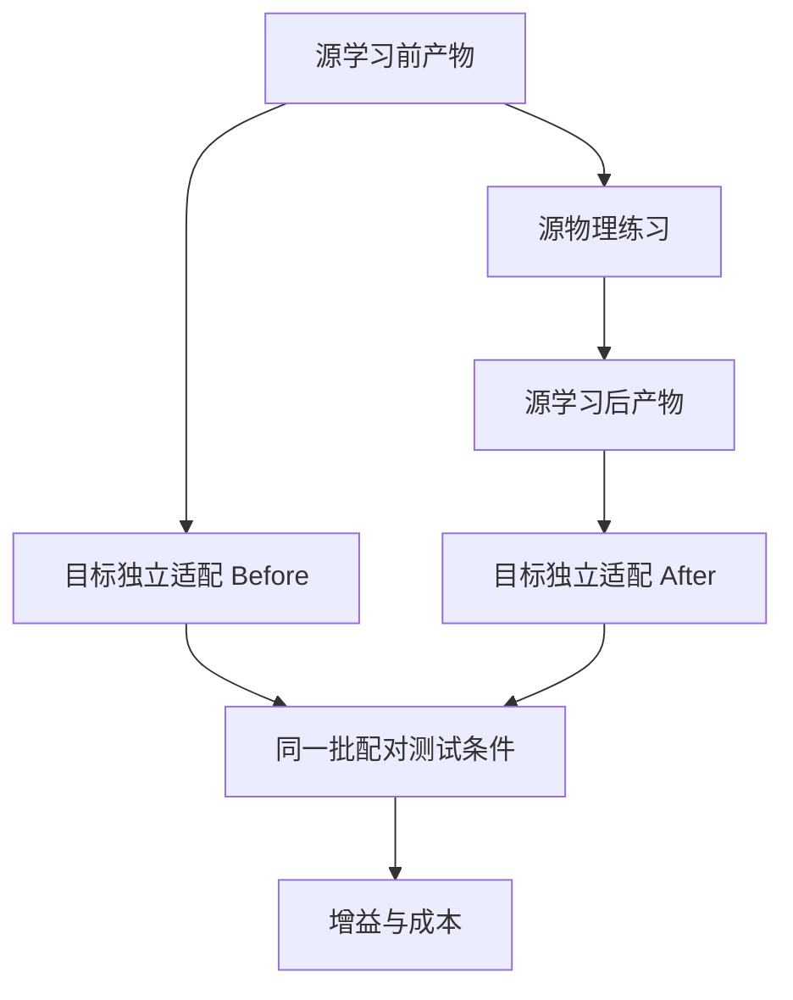

# PhysicalEvoBench-X protocol v0.1

Status: development implementation, NOT physically validated or frozen.

五维可执行参数，而非自由代码

### 8.1 首版字段

```yaml
schema_version: "physicalevobench_x.skillspec.v1"
controller_family: "grasp_lift_state_v1"
parameters:
  grasp_height_fraction: 0.50
  pregrasp_clearance_m: 0.07
  settle_time_s: 0.30
  lift_vmax_mps: 0.10
  lift_amax_mps2: 0.30
requirements:
  end_effector: "parallel_jaw"
  action_interface: "cartesian_pose_and_binary_gripper"
```

| 字段 | 物理解释 | 初始开发边界 |
|---|---|---|
| `grasp_height_fraction` | 物体底面到顶面之间的相对抓取高度 | 0.25–0.75 |
| `pregrasp_clearance_m` | 预抓取点相对抓取点沿接近轴的净空 | 0.04–0.12 m |
| `settle_time_s` | 闭夹后、抬升前的等待时间 | 0.10–0.80 s |
| `lift_vmax_mps` | 抬升轨迹最大线速度 | 0.03–0.20 m/s |
| `lift_amax_mps2` | 抬升轨迹最大线加速度 | 0.10–0.80 m/s² |

这些边界须与任务范围一起经过开发可行性验证并冻结。v0.1 不允许 learner 修改抓力、关节驱动增益、碰撞摩擦、物体质量、控制频率、动作缩放、终止条件或测试集。

### 8.2 真实生效与敏感性

五个字段必须在执行器中各有明确消费位置，日志同时保存请求值和执行后的量。对每一字段做低、中、高三点的开发敏感性检查，确认轨迹或时序发生预期变化。

不要求每个参数都提高任务成功率。`pregrasp_clearance_m` 可能主要改变接近时间，规则立方体上的抓取高度也可能影响有限。若最终有效学习只有一个参数，应报告“主要为单参数迁移”，不能因为 schema 有五个字段就宣称复杂技能学习。

### 8.3 Schema 规则

严格拒绝未知字段、NaN/Inf、错误单位、越界值、任意代码字符串和资源访问指令。只接受完整五维参数，不使用未声明的默认值补全模型输出。记录无效候选和确定性回退。

固定格式与 canonical JSON 序列化；浮点处理规则明确，行为 hash 不能依赖 YAML 字段顺序或空格。内容完整 hash 与行为 hash 分开：

- `artifact_hash`：包含完整产物与 provenance，用于溯源。
- `behavior_hash`：覆盖会影响目标决策的有效内容、控制器/适配器/提案器输入与版本，用于等价判定。

来源机器人、学习前/后标签和审计 episode IDs 默认只交给审计器，不放进目标 LLM 提示，避免标签本身成为额外信息。

---

## 9. 固定执行器

状态机建议：`APPROACH → DESCEND → CLOSE → SETTLE → LIFT → HOLD → DONE/FAIL`。

在初始化 settle 完成时冻结抓取参考物体 pose。对几何中心为原点、局部高度 h 的 cuboid，抓取点局部坐标为 `(0, 0, -h/2 + f*h)`。定义 canonical 接近轴 a 的正方向为从夹爪指向物体，则预抓取点 `p_pre = p_grasp - clearance*a`。本任务为顶部接近，a 指向下方。抓取朝向根据冻结的初始物体 yaw 与两夹爪的 canonical 轴定义确定。

1. APPROACH：根据已知物体几何与 pose 确定抓取中心，运动到预抓取点。
2. DESCEND：以固定、共同的接近规则到达抓取点；夹爪保持 OPEN。
3. CLOSE：发送 canonical CLOSE，由适配器映射为 native float。
4. SETTLE：等待 SkillSpec 指定时间；仅使用公开状态，不读成功 oracle。
5. LIFT：进入阶段时记录实际 TCP 位置 `p_lift_0`，固定目标为 `p_lift_0 + (0,0,0.12) m`；用受最大速度/加速度约束的轨迹抬升。不能每步把当前物体高度再加 0.12 m，形成无限追逐目标。
6. HOLD：固定保持目标；根据公开相对运动记录滑脱征兆，由 evaluator 独立判断成功。
7. DONE/FAIL：保存终止前状态。v0.1 默认不自动重抓；若以后加入重试，必须固定策略并计入物理时间/动作预算。

速度规划使用实际 `dt`，不能按“每步移动多少”偷偷依赖控制频率。最大关节速度、工作区约束和安全停止是公共固定底座，不允许 learner 关闭。

该执行器可提供公共滑脱检测与限幅，但这些不是本轮学到的经验。报告中区分“预先存在的执行能力”和“本轮参数更新”。

---

## 10. 源学习：20 回合，探索和验证都计费

### 10.1 探索阶段：12 回合

每个独立 source run 预先固定两个 source-train 条件和四个 source-validation 条件；条件不同于最终审计与目标测试条件。

1. 初始参数 `p0` 在两个 train 条件各执行一次，共 2 回合。
2. proposer 顺序提出 5 个候选；每个候选在同样两个 train 条件各执行一次，共 10 回合。
3. proposer 每次只看此前探索历史；验证集和最终测试集不进入提示。
4. 用冻结选择规则从 `p0` 和 5 个候选中选出一个 `p*`。

因此探索不是 12 个独立场景，而是 6 个参数配置在 2 个公共条件上的比较。日志和报告应准确说明信息量。

随机搜索与 LLM 使用相同初值、参数边界、回合计划和选优器。随机搜索先在归一化五维空间围绕当前 incumbent 做独立扰动，固定 RNG、步幅规则与边界反射策略；不是对五个参数同时乘同一系数。LLM 仅替换候选生成过程。

`random_search_v1` 的具体规则为：将每维线性归一化到 [0,1]，每次从当前探索最优 incumbent 加上独立 `Normal(0,0.20²)` 扰动；用周期为 2 的镜像反射映回 [0,1]，再还原物理单位。五次候选内不退火，不根据验证结果改变搜索分布。目标 b=5/b=20 使用同一规则，只改变候选数。记录 RNG 实现与版本、所有原始候选和反射后的值。

探索采用唯一确定的排序规则。候选在相同 n 个条件上，令 v 为出现任意硬约束违反的回合数，s 为成功回合数，p 为各回合 `clip(max_lift_m/0.08, 0, 1)` 的平均值，t 为平均 penalized completion time：成功时取首次完整成功的执行时间，失败统一填 15.0 s。按 `(-v, s, p, -t, -candidate_index)` 的字典序取最大；p0 的 candidate_index 为 0。p/t 比较先统一四舍五入至 1e-6。只用具有完整有效探索回合的候选，基础设施中断按第 18 节处理。公开高度进度只用于探索排序，短暂抛高不能直接通过验证。

### 10.2 验证阶段：8 回合

`p0` 与 `p*` 分别在同样 4 个 validation 条件执行，总计 8 回合。随后只允许选择保留 `p0` 或接受 `p*`；不能根据验证结果继续生成候选。

\[
B_{source}=2+5\times2+4+4=20.
\]

建议冻结以下更新门槛：

- 候选的硬约束违反次数不得增加。
- 候选验证成功次数更多时接受。
- 成功次数相同且至少有一个成功，只有在失败条件集合不变、共同成功条件上的中位完成时间改善至少 5% 时才接受时间优化；记录 `accepted_on=time`。
- 其余情况保留 `p0`；完全并列时优先原产物，不为了“必须学到东西”制造更新。

开发阶段可以修改这个门槛，但正式实验冻结后不能为某个方法单独修改。四个验证条件上的接受只是算法决策，不是统计显著改善的证明。

先检查有效更新是否存在：若 p* 与 p0 的有效技能语义和执行行为等价，统一记 `NO_BEHAVIOR_CHANGE`、`accepted_update=false`，不因两批验证的仿真噪声而算作接受了更新。等价指确定性规范化/编译可确认的等价，包含影响后续提案输入的字段，不是“这几个回合结果恰好相同”。回合仍按计划真实执行并计费；数值门槛结果仅作诊断，源审计和目标适配按等价规则 alias。

### 10.3 源审计

冻结 before/after 后，在相同的 50 个独立 source-audit 条件上配对评测。两产物有效执行行为等价时，源审计也复用同一结果、记录 alias，源增益为 0。审计结果不允许选择“最好 donor”、换初值或再改参数。报告源端真实泛化增益，并保留 accepted/rolled-back 的全部 run。

如果源端审计没有改善，但经验帮助了目标，仍可称为“源交互经验的迁移”；不能据此声称 A 已经掌握更强技能。如果所有源更新都回滚，应输出 `NO_ACCEPTED_UPDATE`，不能把失败伪装成成功进化。

---

## 11. 目标适配预算：0、5、20

| 预算 | 探索 | 验证 | 实际信息量 |
|---|---|---|---|
| `b=0` | 无 | 无 | 无新增目标任务练习；仍有共同标定与固定控制底座 |
| `b=5` | 初始参数和 2 个候选，各在 1 个 train 条件执行：3 回合 | 初始参数和选中候选，各在 1 个 validation 条件执行：2 回合 | 2 个独立目标条件 |
| `b=20` | 初始参数和 5 个候选，各在 2 个 train 条件执行：12 回合 | 初始参数和选中候选，各在 4 个 validation 条件执行：8 回合 | 6 个独立目标条件 |

每个预算必须从同一输入 SkillSpec 的 fresh snapshot 启动。`b=5` 不继承 `b=20` 产生的候选或反馈，也不继承另一个实验条件的目标历史。

每次目标适配创建全新的 proposer 实例与对话上下文。目标端只能读取输入 SkillSpec、公共任务/本体说明、本次目标适配已产生的探索历史。不得继承源历史、源 LLM 会话、rationale、KV 缓存或其他预算状态。源完整历史仅用于审计和 RawReconstruct。目标适配沿用第 10 节相同的探索排序和验证接受规则，只改变回合数量。

图表名称为 **budget-response curve（预算响应曲线）**。这些是不同预算的独立运行，不是同一个 learner 持续学习轨迹。

目标适配完成后冻结输出 SkillSpec 和 learner 持久状态，再开始正式评测。测试回合内部允许固定 executor 根据正常状态闭环；不同测试回合之间重置临时状态，禁止追加记忆、重新提案或更新参数。`b=0` 的准确含义是“零新增目标任务交互”，不能写成“目标本体从未训练或标定”。

---

## 12. 因果对照、等价合并与基线

### 12.1 主估计量

对每个 A→B 方向、目标预算 b 和完整 run seed：

\[
\Delta_{new}(A\!\to\!B,b)=SR_B(Adapt_B(K_A^{after},b))-SR_B(Adapt_B(K_A^{before},b)).
\]

两边必须共享目标控制器、适配器、提案器版本、目标训练条件、评测条件与配对 RNG 规则。唯一计划变化是源端新产生的有效经验。

这估计的是**本轮新增源经验的边际收益**。如果还需要报告“相对于完全没有源经验的收益”，另设 TargetOnly；若它与 SourceBefore 实际等价则合并，不能伪造三个独立方法。



### 12.2 等价条件合并

判断等价必须检查全部目标可见且影响决策的内容：有效参数、编译结果、控制器、适配器、提案器输入、随机状态、可访问历史和选项。不能只比较原始 JSON 中五个浮点数。

v0.1 的初始 p0 通常与 TargetOnly 相同，可在同一 run package 内建立 alias。更关键的是：**源端回滚导致 After 与 Before 等价时，复用同一次目标适配与评测结果**，迁移增益精确为 0。否则相同技能的两次 LLM 随机输出会制造假的正/负迁移。

实现上区分 `skill_semantic_hash`（有效技能内容）、`execution_identity`（技能加本体/控制器/适配器/条件/运行设置）、`target_adaptation_identity`（有效输入加目标 proposer 可见上下文、随机状态和版本）。笼统的 behavior_hash 是这些 identity 的上层记号；不把目标不可见的源历史纳入目标等价判定。完整 provenance 由 artifact_hash 和独立审计链管理。

即使 temperature=0，也不假设远程模型完全确定。跨独立 run seed 不做这种结果复用，避免把独立重复变成复制记录。

记录 `aliases.json`，保留逻辑实验请求、真实执行和预算收费的区别。只有行为和信息等价的实验条件可以 alias；训练过程中的普通重复候选不因为碰巧参数相同就获得免费缓存经验。

### 12.3 基线集合

| 名称 | 实际用途 | v0.1 要求 |
|---|---|---|
| Initial / TargetOnly | 无新增源经验时目标自身适配 | 与 SourceBefore 等价时 alias |
| SourceBefore | 源学习前产物 | 主对照 |
| SourceAfter | 源学习后冻结产物 | 主处理组 |
| Random-search learner | 检查简单参数搜索的迁移能力 | 必须完整跑通，不能只测 LLM |
| Bounded-LLM learner | 检查模型根据物理反馈提出参数的能力 | 使用实际模型请求、相同物理预算 |
| RawReconstruct | 从完整源历史重建最终 SkillSpec | 一致性审计，不是刻意弱化的排行榜基线 |

RawReconstruct 必须能依据候选、反馈、选择规则和验证决策，确定性重建相同有效产物。它检验日志完整性和因果链。不能给一个不会读取原始轨迹的系统塞入轨迹，再宣称“技能格式优于原始经验”。

后续表示研究应固定同一份 source experience，比较原始历史、参数摘要、条件技能等表示，并匹配目标模型预算。它与 v0.1“主动生成源经验”的协议是两个问题，应分别命名和报告。

---

## 13. 条件、种子和数据隔离

### 13.1 数据划分

至少划分：`dev`、`source_train`、`source_validation`、`source_audit`、`target_train`、`target_validation`、`target_test`。

source 和 target 的首版条件来自同一冻结物理分布，但使用不重叠的具体实例。这样先隔离本体变化；质量外推、视觉变化、陌生物体属于另一个 OOD track，不能全部混进首版后无法归因。

相同 artifact condition 和 learner 比较使用同一批显式 condition manifest。提前成功、提前失败或 episode 长度不同，不能改变下一个测试条件。仅设置全局 seed 不足以保证配对。

每个 condition 应包含真实初始位姿、初始速度、物体几何、物理参数、settle 规则和随机化版本。evaluator 记录 reset 后实际生效的状态；超出重置容差视为 infra-invalid，按统一重试规则处理。不同本体之间只要求共同任务条件，不要求机器人各关节状态数值相同。

### 13.2 种子包

```yaml
run_seed_id: 0
source_learning_seed: 10001
target_adaptation_seed: 20001
proposal_rng_seed: 30001
condition_manifest_id: "pilot_split_v1"
```

数字只是配置示例，正式包由固定生成器产生。三个 package 是三个独立完整学习重复，不是把同一个源技能在三个环境 seed 上测一遍。

在 Before/After 内配对 target RNG 和条件，但记录外部模型服务可能无法精确复现的部分。源学习 seed、目标适配 seed、物理 reset seed 和提案 RNG 分开记录，避免复用一个整数掩盖不同随机源。

### 13.3 信息边界

模型可见：参数含义与边界、任务公开目标、实际 public observation 的摘要、先前训练回合的反馈和自身提案历史。

模型不可见：隐藏质量/摩擦真值、test manifest、测试种子、评价代码内部状态、未来回合反馈、其他实验条件的历史。条件 ID 使用不编码隐藏值的 opaque ID。

本地开发可用独立进程和显式 allowlist，但需标注这不是对恶意同机代码的强隔离。正式外部提交采用独立 learner 容器/用户，不挂载私有测试文件，不给 Docker socket，不给 evaluator 写权限；允许的模型服务请求也必须经过相同日志与预算通道。文件 hash 只能校验完整性，不能代替访问隔离。

最终公开的复现集可以发布 manifest；需要持续避免过拟合的官方测试集由评测端持有。公开复现集与隐藏官方集分别标注，不能同时宣称同一批公开条件永远不可见。

---

## 14. LLM 提案器的最小实现

LLM 只在回合之间工作，不能在 50 Hz 控制循环中等待模型。每次请求包含固定任务说明、五维参数定义、当前 incumbent、合法历史摘要和固定输出 schema。

模型输出仅包含 SkillSpec 允许的字段；自然语言 rationale 可单独写审计文件，但不参与动作执行，也不带入后续目标条件形成额外经验通道。

建议首版调用约束：每个候选最多 1 次正常生成与 1 次格式修复；每次最多 6,000 输入 token、800 输出 token；单次请求有固定超时。实际 provider 的 token 统计优先，同时记录本地估计方式。上下文裁剪使用确定性规则，不由人工挑选成功片段。

| 阶段 | 候选数 | 最大请求数，含一次格式修复 |
|---|---:|---:|
| 源学习 20 | 5 | 10 |
| 目标预算 0 | 0 | 0 |
| 目标预算 5 | 2 | 4 |
| 目标预算 20 | 5 | 10 |

达到请求上限仍无合法输出，则回退到当前合法 incumbent；按原定计划执行且计入物理预算，记录失败原因。不能无限免费修复 JSON，不能在超预算后换模型继续搜索。

固定并记录 provider、准确模型 ID/可用 revision、temperature、seed 支持情况、提示模板 hash、输入输出 token、请求时间、完整候选与解析结果。密钥通过环境变量提供，不写入仓库或日志。

在同一 proposer 内，Before/After 的模型、调用上限与历史权限必须相同。Random 与 LLM 的主要公平控制是物理预算相同；二者推理成本不相同，应另行报告，不能称为全部计算预算完全匹配。

后续要将收益归因于“利用物理反馈”，还需无反馈但推理次数相同的 proposer 控制组。v0.1 可以证明经验产物导致目标行为变化，不自动证明 LLM 比搜索更会推理。

---

## 15. 实验规模、成本与统计

### 15.1 工程 smoke

先运行一个方向、一个 run seed、两种 artifact condition、目标预算 0/5、每格 10 个测试条件：逻辑目标评测 `2×1×1×2×10=40` 回合。源学习 20 回合，目标适配 10 回合；源审计可先用每组 10 条件，再进入完整 pilot。

这个 smoke 只证明流程可运行，不进入正式性能主表。真实别名复用会减少实际执行数。

### 15.2 完整 pilot：每个 learner 的配额

| 类别 | 计算 | 未去重回合数 |
|---|---|---:|
| 源学习 | 2 个源本体 × 3 个完整 run × 20 | 120 |
| 目标适配 | 2 方向 × 3 run × 2 artifact × (5+20) | 300 |
| 源审计 | 2 个源本体 × 3 run × 2 artifact × 50 | 600 |
| 目标正式评测 | 2 方向 × 3 run × 2 artifact × 3 budget × 50 | 1,800 |
| **合计** | 不含开发、标定和基础设施重试 | **2,820** |

Random 和 LLM 都完成时，未去重逻辑配额为 5,640 回合。source experience 对三个目标预算复用，不能每个预算假装重新获得一次源经验；报告源一次性成本和后续复用成本。

保存四个计数：`logical_episode_requests`、`physical_episode_executions`、`aliased_episode_requests`、`budget_charged_episodes`。它们含义不同。统计有效样本时以独立完整学习 run 为主，不能把 1,800 个目标回合宣称为 1,800 次独立学习实验。

### 15.3 主指标

必须报告：

- 源 before/after 审计成功率与源更新接受/回滚数量。
- 目标 before/after 成功率、每个 run 的配对差值、各预算的平均差值。
- A→B 与 B→A 分开结果；再提供清晰标注的总体描述。
- 失败类型、硬约束违反、完成时间及基础设施无效率。
- 源/目标练习回合、验证回合、最终评测回合、模拟时间、墙钟时间、GPU 占用时间、模型调用与 token。

负迁移分成“观察到负增益”和“有稳定负迁移证据”。不能把动作编码错误、不可达或数据串扰当成学习意义上的负迁移。

三个独立 run 属于 pilot，报告所有点、范围和均值；不要靠大量测试回合制造强显著性。正式研究建议至少 5 个独立完整学习 run，做按学习 run 与测试条件分层的配对不确定性分析，并说明其统计假设。

若使用达到成功率阈值所需的目标回合数，未达到阈值应记 censored / not reached，不能填 0。只有三个预算点时不精确插值假装已测出完整样本效率曲线。

### 15.4 成本的两个视角

“目标机器人减少试错”与“整个系统更省资源”分别回答。前者在同目标预算下测迁移；后者还要计源经验获取成本。

可提供 N 个目标复用时的账本：`源获取成本 + N×单目标适配成本`，与 `N×TargetOnly 成本` 比较。单位分开列为回合、GPU 时间、token；只有有明确计价依据时才换算货币，不把不同资源任意相加为一个分数。

---

## 16. 数据契约与证据文件

### 16.1 ObservationFrame：运行时观察

至少包含：`schema_version`、`episode_id`、`sim_time_s`、joint positions/velocities、canonical TCP pose、object pose/linear velocity/angular velocity、物体已知尺寸、实际 gripper opening width、固定 workspace limits。

位姿使用 SI 单位、明确 world frame 和 `xyzw` 顺序。状态由同一仿真时间点读取，转换为独立数据副本，不能向外暴露可写 tensor view 或完整 env 对象。缺失字段须明确报错，不能以零填充模拟传感器正常。

质量、摩擦、质心扰动、成功判定布尔和私有条件参数不属于 ObservationFrame。已知几何是本 track 的公开特权信息，应在论文和 README 中明确。

### 16.2 EpisodeFeedback：训练结束后的反馈

建议包括：`task_success`、公开约束违反、最大实际抬升高度、合法稳定保持时长、滑脱观测摘要、阶段耗时、终止原因、对应 SkillSpec hash。测试阶段反馈只进入 evaluator，不进入 learner。

公开进度指标必须提前定义，所有 learner 同样可用；不能对 LLM 提供人工诊断，而给随机搜索仅一个失败位。

### 16.3 运行清单

```yaml
protocol_version: "pebx_x_v0.1"
task_id: "PEBX-StableLift-v0"
task_definition_hash: "generated_at_freeze"
split_manifest_hash: "generated_at_freeze"
run_seed_id: 0
donor_learner_id: "random_search_v1"
receiver_learner_id: "random_search_v1"
source_body_id: "franka_panda"
target_body_id: "franka_robotiq"
target_budget: 5
artifact_condition: "source_after"
source_budget_cap: 20
source_budget_used: 20
backend: "physx"
isolation_level: "process_allowlist"
formal_result_eligible: false
```

上面的 hash 字符串是文档示意，正式 schema 要拒绝这些占位值；冻结时写入真实 hash。`formal_result_eligible` 只能由验证器根据条件生成，不能由 proposer 设置为 true。

### 16.4 每回合记录

至少记录以下字段：

| 类别 | 字段 |
|---|---|
| 身份 | run_id、episode_id、opaque condition_id、split、phase、direction、run_seed_id |
| 版本 | repo commit、Arena/Lab commit、image digest、task/controller/adapter/observation/action schema hash |
| 技能 | input artifact_hash、input behavior_hash、executed behavior_hash、candidate_id |
| 随机性 | reset seed、proposal RNG、target adaptation seed、attempt_index |
| 结果 | task_success、constraint violations、termination reason、completion time、hold time、max lift |
| 物理证据 | 初始实际状态、终止前状态、轨迹文件路径和 checksum、请求/执行动作 |
| 成本 | simulator steps、模拟时间、墙钟时间、训练/验证/测试预算类别 |
| 有效性 | infra_failure、protocol_valid、backend、actual_execution、alias_of |

源学习另记 before/after hash、所有探索/验证 episode IDs、选择理由、接受/回滚结果。模型调用另记提示、响应、token、格式修复、超时和回退，不记录密钥。

### 16.5 每个 run 的产物布局

```text
runs/<run_id>/
  run_manifest.json
  dependency_snapshot.json
  protocol_snapshot.yaml
  embodiment_diff.json
  calibration/
  source/
    before.json
    after.json
    selection.json
    episode_results.jsonl
    proposal_requests.jsonl
    proposal_responses.jsonl
  targets/<direction>/<budget>/<artifact_condition>/
    input.json
    frozen_output.json
    adaptation_results.jsonl
    evaluation_results.jsonl
  trajectories/
  videos/
  costs.json
  aliases.json
  validation_report.json
  summary.json
  report.md
```

私有 condition manifest 放在 evaluator 专属目录，不挂载到 learner。报告可引用 manifest hash。轨迹使用 NPZ/HDF5 等本地验证后的格式，至少包含控制频率下的公开状态与真实动作；需要分析接触或数值不稳定时，再采集更高频诊断。视频只是辅助证据，不能替代轨迹与完整回合表。

发布最少应包括：协议版本、依赖锁、双本体差异、初始技能、全部汇总与失败统计、可再生成图表的结构化结果、固定选择规则，以及明确的复现步骤。

---

