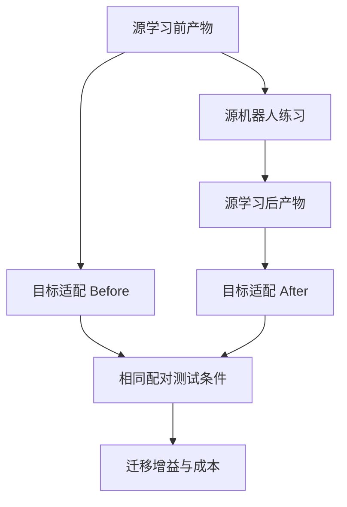

**PhysicalEvoBench-X 适合现在就独立建仓库。建议把首版目标明确为：建立一套可复现的实验，测量“机器人 A 新获得的经验，是否在相同适配预算下帮助机器人 B”，然后逐步扩展到条件技能、不同机械臂和多轮继承。**

我已经完成相关工作调研、Arena 固定版本源码核查，以及技术和实验协议审查，整理成了一份 **25 个章节的 Codex 实施任务书**：

**:chatgpt-content-reference{index="4"}[PhysicalEvoBench-X_Codex_Implementation_v0.1.md](sandbox:/workspace/scratch/77ee2a8f11ff/PhysicalEvoBench-X_Codex_Implementation_v0.1.md)**

文件包含项目背景、仓库初始化命令、依赖版本、源码入口、目录结构、接口、配置示例、实验预算、统计方法、P0–P7 验收标准，以及可以直接粘贴给本地 Codex 的启动指令。

下面把最关键的实施决策和理由展开说明。

---

## 一、项目应该如何定位

建议采用：

- **仓库：**`ros-claw/PhysicalEvoBench-X`
- **Python 包：**`physicalevobench_x`
- **命令行：**`pebx`
- **中文定位：**跨本体新增经验迁移与持续改进基准。
- **英文副标题：**  
  *Measuring whether newly acquired robot experience improves another embodiment under matched adaptation budgets.*

这个仓库应当可以独立安装、运行和复现。**ROSClaw 通过公共接口参加评测，基准本身保持对不同 Agent 系统的兼容性。**

### 真正值得测量的问题

“机器人之间能否迁移能力”已经有大量研究：

| 相关工作 | 已经覆盖的问题 | PhysicalEvoBench-X 应进一步明确的内容 |
|---|---|---|
| Open X-Embodiment / RT-X | 多机器人数据共享与跨机器人训练 | 本轮新增经验带来的边际收益 |
| AnyBody | 多种形态的控制学习和泛化 | 源端交互、经验产物、目标适配的完整过程 |
| ZETA | 受控跨本体 VLA 迁移及目标本体暴露 | 目标究竟用了多少数据、标定和交互 |
| BARX | 行为对齐表示对迁移的作用 | 在相同来源经验下比较不同经验表示 |
| EmbodiedEvo | 物理反馈驱动的经验更新与复用 | 经验跨硬件配置传递后的收益、成本与失效条件 |

这些工作意味着，项目应避免“首次跨本体迁移”一类定位。更有价值的研究贡献是，**把新增经验、基础能力、本体适配和目标继续学习分开测量。** [robotics-transformer-x.github.io](https://robotics-transformer-x.github.io/?utm_source=chatgpt.com)

核心问题可以具体表述为：

> A 经过一轮物理练习后产生的经验，与 A 练习前的经验相比，给 B 带来了多少额外帮助？这些帮助是否减少了 B 的试错，是否值得源端获取经验的成本？

这也决定了项目的核心对照必须包含 **SourceBefore 与 SourceAfter**，而不能只展示“某个进化后的系统成功了”。

---

## 二、首版范围：先完成可信的双向迁移闭环

我建议首版采用下面这套配置。

| 维度 | v0.1 方案 |
|---|---|
| 仿真平台 | 固定提交的 Isaac Lab-Arena，统一 PhysX |
| 本体 A | Franka + Panda Hand |
| 本体 B | Franka + Robotiq 2F-85，即 DROID 配置 |
| 迁移方向 | A→B，以及 B→A |
| 任务 | 自定义 StableLift：抓起物体并稳定保持 |
| 观察 | 物体与机器人状态、已知物体几何 |
| 基础执行器 | 一套共享、冻结的状态机与轨迹生成器 |
| 经验产物 | 五维物理参数 `SkillSpec` |
| 学习方法 | 随机搜索提案器 + 有界 JSON 的 LLM 提案器 |
| 源学习预算 | 20 个物理回合，包含验证 |
| 目标适配预算 | 0、5、20 个物理回合 |
| 正式测试 | 冻结产物后，在配对条件上评测 |

### 为什么先选这两个本体

固定版本的 Arena 已经提供：

- `franka_ik`
- `droid_differential_ik`

因此可以复用现成差分 IK，把主要工程投入放在共同任务、物理接口、学习协议与评测上。相关实现可见固定版本的 [Franka 源码](https://github.com/isaac-sim/IsaacLab-Arena/blob/c7edf3a9d5d8276565208f72422f8f8a0806d6cf/isaaclab_arena/embodiments/franka/franka.py)和 [DROID 源码](https://github.com/isaac-sim/IsaacLab-Arena/blob/c7edf3a9d5d8276565208f72422f8f8a0806d6cf/isaaclab_arena/embodiments/droid/droid.py)。

但这两种配置使用的是同一机械臂家族，变化集中在夹爪及工具几何。因此，首版应准确称为：

> **末端执行器变化下的近本体经验迁移试验。**

它能证明协议是否成立、经验是否确实影响另一种硬件配置的表现。不同臂长、关节数、运动学结构之间的迁移，需要后续加入另一机械臂家族。

### 为什么首版使用状态观察

首版已经有足够多的变量需要控制：夹爪几何、接近方向、工具中心、接触动力学、经验更新与目标预算。

使用明确声明的 **state-based / privileged-geometry track**，可以先回答经验迁移问题。视觉感知和 VLA 泛化可以作为后续独立赛道加入。

这样也容易判断失败究竟来自：

- 控制适配错误；
- 基础抓取失败；
- 源端没有学到有效经验；
- 经验不适用于目标；
- 目标适配预算不足。

---

## 三、Arena 的可行性已经具体到源码入口，但有几个关键工程问题

### 1. 固定依赖组合

本次核查采用的提交是：

```text
Isaac Lab-Arena:
c7edf3a9d5d8276565208f72422f8f8a0806d6cf

Isaac Lab:
91a0906f93802eb859192dcb0bca879f891e92d6
```

该 Arena 提交的 Dockerfile 使用：

```text
nvcr.io/nvidia/isaac-sim:6.1.0
```

Python 要求为：

```text
>=3.12,<3.13
```

这里有一个容易误导实施者的地方：对应 `pyproject.toml` 中的包版本仍写着 `0.3.0`。因此应锁定 **Git SHA、镜像 digest、资产版本和实际运行环境**，不能只依赖 Python 包版本字符串。[Dockerfile](https://github.com/isaac-sim/IsaacLab-Arena/blob/c7edf3a9d5d8276565208f72422f8f8a0806d6cf/docker/Dockerfile.isaaclab_arena)与 [pyproject.toml](https://github.com/isaac-sim/IsaacLab-Arena/blob/c7edf3a9d5d8276565208f72422f8f8a0806d6cf/pyproject.toml)是任务书中的具体依据。

建议将 Arena 保留为未修改的 git submodule，自定义任务、控制器与协议放在新仓库中。Arena 官方也提供在外部仓库扩展任务和本体的方式。[isaaclab_arena](https://isaac-sim.github.io/IsaacLab-Arena/main/pages/arena_in_your_repo/external_tasks_and_embodiments.html?utm_source=chatgpt.com)

### 2. 两台机器不能直接共用原始动作向量

源码核查发现，两种夹爪的开闭编码不同：

| 动作 | Panda Hand | DROID / Robotiq |
|---|---:|---:|
| CLOSE | `-1.0` | `1.0` |
| OPEN | `1.0` | `0.0` |

所以公共接口应使用 `OPEN/CLOSE` 枚举，再由适配器编码。[DROID 动作实现](https://github.com/isaac-sim/IsaacLab-Arena/blob/c7edf3a9d5d8276565208f72422f8f8a0806d6cf/isaaclab_arena/embodiments/droid/actions.py)和 [Lab binary action 实现](https://github.com/isaac-sim/IsaacLab/blob/91a0906f93802eb859192dcb0bca879f891e92d6/source/isaaclab/isaaclab/envs/mdp/actions/binary_joint_actions.py)明确了这一差异。

**这类适配错误必须在学习前排除。** 否则最后测到的“负迁移”，可能只是目标机器人收到了反向夹爪命令。

### 3. TCP 定义需要统一

两种模型的控制点、观测点和名义抓取中心不一致。尤其 Robotiq 的抓取中心会随夹爪运动略有变化。

任务书要求：

- 用两指 pad 的几何中点定义公共 TCP 位置；
- 用冻结的轴映射定义 TCP 姿态；
- 用完整 SE(3) 变换转换到原生 IK 控制点；
- 再处理 robot root frame、相对位姿增量与 action scale。

不能把一个固定偏移直接加到世界坐标，也不能把一台机器的末端原点当成另一台机器的抓取中心。上述几何差异来自固定版本的 Franka/DROID frame 配置。

### 4. 时间、reset 和成功判定必须接通同一套逻辑

任务书已经明确：

- 物理步长：`0.005 s`；
- 控制周期：`0.02 s`；
- 初始化静置：`0.5 s`；
- 执行窗口：`15 s`；
- Arena 总 episode timeout：`15.5 s`。

Arena 的默认配置并非 50 Hz，需要显式设置并在启动后验证。[控制频率配置源码](https://github.com/isaac-sim/IsaacLab-Arena/blob/c7edf3a9d5d8276565208f72422f8f8a0806d6cf/isaaclab_arena/environments/isaaclab_arena_manager_based_env_cfg.py)

成功状态、Gym 终止原因、训练反馈与最终统计应从同一份权威任务状态派生。终止证据要在自动 reset 前保存，否则读取到的可能已经是下一回合的物体状态。

### 5. 仿真与模型推理可以分机

优先在 RTX A6000 机器上验证仿真环境，再根据实际兼容性结果安排运行；H800 集群可以承担模型推理。

这里的依据是官方 Isaac Sim 要求明确列出无 RT Cores 的 A100/H100 不受支持。因此不能仅按显存容量选择仿真主机，仍要完成当前版本的兼容性检查。[Isaac Sim Documentation](https://docs.isaacsim.omniverse.nvidia.com/latest/installation/requirements.html?utm_source=chatgpt.com)

---

## 四、机器人具体“学到什么”

首版经验产物为五维 `SkillSpec`：

```yaml
parameters:
  grasp_height_fraction: 0.50
  pregrasp_clearance_m: 0.07
  settle_time_s: 0.30
  lift_vmax_mps: 0.10
  lift_amax_mps2: 0.30
```

| 参数 | 物理含义 |
|---|---|
| `grasp_height_fraction` | 在物体高度的什么位置抓取 |
| `pregrasp_clearance_m` | 预抓取点距离抓取点多远 |
| `settle_time_s` | 闭夹后等待多久再抬升 |
| `lift_vmax_mps` | 抬升最大速度 |
| `lift_amax_mps2` | 抬升最大加速度 |

这里给出的是实施初值，正式范围需要通过开发集的机械可行性与敏感性检查后冻结。

### 为什么没有“抓力参数”

两个现成 IK 配置的夹爪都是 binary open/close。首版若直接加入连续抓力或开度字段，容易出现模型修改了 JSON，执行器却没有真正改变物理动作的情况。

因此，首版只开放可以明确执行、记录和验证的参数。连续开度或力控制需要另行扩展动作配置、标定并验证，再进入新版本。

### 如何证明这些参数确实有用

每个参数都要进行开发敏感性检查：

1. 分别设置低、中、高三个值。
2. 记录请求参数和实际轨迹。
3. 检查动作、时序或任务表现是否发生对应变化。
4. 报告弱敏感或完全无效的维度。

如果最后主要只有抬升速度影响结果，就如实报告“主要为单参数迁移”。五个字段本身不构成复杂技能学习的证据。

### LLM 在哪里参与

LLM 在回合之间读取反馈、提出下一组参数。50 Hz 的控制由固定执行器完成。

同时必须实现随机搜索基线。它有两个作用：

- 不依赖模型服务也能验证完整实验流程；
- 判断 LLM 的效果是否超过简单参数搜索。

这让项目以后可以清楚区分“经验热启动有效”和“Agent 更善于总结、使用经验”。

---

## 五、最重要的实验设计：比较源学习前后

定义：

- \(K_A^{before}\)：A 本轮练习前的技能。
- \(K_A^{after}\)：A 练习后冻结的技能。
- \(b\)：B 的新增适配回合预算。

主要指标为：

\[
\Delta_{\text{new}}(A\rightarrow B,b)
=
SR_B(K_A^{after},b)
-
SR_B(K_A^{before},b).
\]

两边使用相同的目标控制器、适配器、学习方法、训练条件和测试条件。



### 源学习：20 回合

具体拆分为：

- 初始参数在两个训练条件各执行一次：**2 回合**。
- 提出五个候选，每个候选在这两个条件执行：**10 回合**。
- 选出一个候选，与初始参数在四个验证条件配对比较：**8 回合**。

合计：

\[
2+5\times2+4+4=20.
\]

验证之后只能接受候选或回滚，不能继续根据验证结果搜索。

### 目标适配：0、5、20 回合

| 预算 | 探索 | 验证 |
|---|---:|---:|
| 0 | 0 | 0 |
| 5 | 3 | 2 |
| 20 | 12 | 8 |

三个预算分别独立启动。`b=5` 不得继承 `b=20` 的经验。

因此最终得到的是**预算响应曲线**，而非同一个 learner 的连续学习曲线。

### 必须防住三个容易产生假收益的问题

**第一，目标模型必须使用全新上下文。**

它只接收 SkillSpec、公共任务说明和本次目标练习历史，不能继承源 LLM 会话、源失败日志、rationale 或其他预算的状态。否则转移的就不止是声明的五维经验。

**第二，没有有效更新就不能产生“迁移收益”。**

如果源端回滚，导致 Before 与 After 的有效输入相同，两组应复用同一次目标适配与评测结果，记录 alias，增益为零。

相同技能分别调用两次 LLM 得到不同结果，不能解释为源经验的作用。

**第三，原始经验对照不能被故意做弱。**

首版要求实现 `RawReconstruct`：根据完整源历史与选择规则，重建相同技能产物。这用于验证经验来源与记录完整性。

以后比较“原始历史、参数摘要、条件技能”时，应固定来源经验与目标处理预算，再比较不同表示。

---

## 六、任务怎么定义，才能避免只有成功视频

建议新增 `PEBX-StableLift-v0`，要求：

1. 物体相对初始化后的高度上升至少 **8 cm**。
2. 物体与 TCP 的相对位姿保持稳定。
3. 物体速度处于冻结阈值内，排除抛掷越线。
4. 上述条件连续保持 **1 秒**。
5. 没有工作区越界或其他规定的硬失败。

首版先采用明确尺寸的程序刚体，在共同可达区域内进行小范围位置、yaw 和质量变化。摩擦与质心扰动可以后续逐项加入，避免同时引入太多因素。

实施中需要证明：

- 质量变化确实进入物理后端；
- 物体没有被吸附、焊接或直接设置位姿；
- 参数修改确实改变执行；
- 短暂越线、滑脱和抛掷不会被误判；
- 两种本体均有共同可行的任务条件。

**正式测试前冻结难度与判定规则。** 如果基础策略已经成功率饱和，应报告当前任务缺少区分度；不能为制造迁移收益而削弱对照。

---

## 七、仓库应该实现哪些模块

任务书给出了完整目录，核心职责可以概括为：

| 模块 | 职责 |
|---|---|
| `sim/` | Arena 启动、任务、资产、状态读取、条件施加 |
| `control/` | 公共动作、两个本体适配器、轨迹与固定执行器 |
| `learners/` | 随机搜索、LLM 提案器、固定提示模板 |
| `core/` | Schema、预算、hash、条件、选择与等价判定 |
| `protocol/` | 源学习、目标适配、冻结评测、编排和重建 |
| `reporting/` | 汇总、图表、成本和失败报告 |
| `tests/` | CPU 协议检查与真实 GPU 验收 |

计划中的命令包括：

```text
pebx doctor
pebx calibrate
pebx smoke
pebx freeze
pebx acquire
pebx adapt
pebx evaluate
pebx run
pebx validate-run
pebx reconstruct
pebx report
```

**这些是交给 Codex 实现的接口，并非已经存在的工具。** 文档明确区分了上游真实 API 和项目待实现 API，避免实施者拿着规划命令直接尝试运行。

每个实验都要产出版本快照、技能前后文件、候选历史、逐回合结果、轨迹、成本账本、alias 清单和报告。视频作为辅助证据。

---

## 八、首版实验规模与资源安排

完整 pilot 建议采用：

- 两个迁移方向；
- 三个独立完整学习种子包；
- Before/After 两种产物条件；
- 三档目标预算；
- 每格 50 个目标测试条件。

每个 learner 的未去重配额如下：

| 类别 | 回合数 |
|---|---:|
| 源学习 | 120 |
| 目标适配 | 300 |
| 源 before/after 审计 | 600 |
| 目标正式评测 | 1,800 |
| **合计** | **2,820** |

随机搜索与 LLM 两套完整系统合计为 **5,640 个逻辑回合**。等价结果复用会减少实际执行数；开发、标定和基础设施重试另计。

这里需要特别注意：

> 1,800 个测试回合，不等于 1,800 次独立学习实验。

每个方向只有三个独立完整学习重复，因此首版属于 pilot，应报告每个 run 的结果、范围和失败原因，避免作过强的显著性结论。

正式研究再根据方差和希望达到的精度增加独立源学习次数。

算力安排上，先测 100 个回合的实际吞吐，再安排完整批次。源端有反馈依赖的候选生成需要顺序执行；不同方向、种子包和冻结后的目标预算可以独立调度。

---

## 九、交给 Codex 的实施顺序与验收

| 阶段 | 做什么 | 验收证据 |
|---|---|---|
| **P0** | 独立仓库、依赖锁、容器、doctor | 固定环境下真实 reset/step |
| **P1** | 双本体、TCP、夹爪与共同场景 | 轴向检查、真实开闭、名义抓取轨迹 |
| **P2** | StableLift、固定执行器、五维参数 | 判定正确、参数实际生效 |
| **P3** | 源学习、随机搜索、选择与回滚 | 20 回合预算完整、产物可重建 |
| **P4** | 目标预算、Before/After、alias、隔离 | 一个方向的完整迁移 smoke |
| **P5** | 有界 LLM 提案器 | 真实请求、反馈、候选与调用账本 |
| **P6** | 双向完整 pilot | 全部结果、成本、失败与不确定性 |
| **P7** | 文档、发布与复现 | 清洁 checkout 可复现 smoke |

我的排期建议是：**为熟悉机器人仿真的小团队预留约 3–5 周完成可信 v0.1**。这是实施估计，资产、驱动和接触物理问题可能延长；已有稳定 Arena 环境可以缩短安装阶段。

第一个有意义的里程碑应当是：

> 两种真实仿真夹爪能够通过同一公共接口执行 StableLift；一次源练习产生的产物能传到另一种配置；Before/After 的区别能够被完整、正确地测出来。

### 工程完成与研究结果分开

工程状态可以是：

- 已通过；
- 环境阻断；
- 协议无效。

研究结果可以是：

- 观察到正收益；
- 没有清晰收益；
- 观察到负收益；
- 没有发生有效源更新；
- 证据不足。

**“工程通过，但没有发现清晰迁移收益”是有效交付。** 它说明项目已经具备可信测量能力，也能指导下一步到底该扩展经验表示、任务还是本体。

---

## 十、怎样继续发展成有分量的研究项目

我认为，**v0.1 的主要价值是把实验基础做扎实；更强的研究价值来自后面的三个扩展。**

### 1. 从参数升级到条件技能

例如，经验产物可以表达：

- 观察到相对滑移时降低抬升速度；
- 根据实际夹爪状态决定是否延长等待；
- 遇到特定失败征兆时终止或重试。

这些规则需要使用受限 DSL、明确复杂度与交互预算，并与“只保留平均参数”“去掉分支”“移除失败证据”等消融比较。

这样才能回答：迁移收益是否来自可复用的条件知识。

### 2. 加入另一机械臂家族

最好形成三种对照：

- 同手臂，换夹爪；
- 换手臂，保留夹爪；
- 手臂与夹爪同时变化。

这能区分经验究竟依赖工具接触特性，还是依赖运动学和控制能力。

### 3. 建立多轮继承

进一步测量：

\[
A \rightarrow B \rightarrow C
\]

不仅看 C 是否提高，还要看：

- 是否优于只接收 A 或 B 的经验；
- 累计成本是多少；
- 旧能力是否退化；
- 系统能否拒绝不适用的经验；
- 负迁移发生在哪里。

有了这些证据，“Evolution”才具有清晰的实验含义。

---

## 给本地 Codex 的使用方式

将上面的 Markdown 文件交给本地 Codex，附上这段指令即可：

> 请按任务书在 `ros-claw` 组织下创建或接续独立仓库 `PhysicalEvoBench-X`，将本文保存为 `docs/implementation_plan.md`，提炼 README、协议文档和 AGENTS.md。  
>   
> 按 P0→P7 顺序实施。先完成固定环境、两个本体的真实控制与名义抓取，验收后继续实现源学习、目标适配、配对评测和完整 pilot。每阶段交付实际代码、命令、日志和验收证据。  
>   
> 使用任务书规定的固定源码、五维 SkillSpec、20 回合源预算、0/5/20 fresh target 预算、Before/After 对照与 alias 规则。模型只在回合之间输出有界 JSON。  
>   
> 不依赖旧 PhysicalEvoBench 完成。遇到 GPU、资产或权限阻断时记录真实原因，同时完成不受阻的实现；不得用 fake 结果冒充物理验证。正迁移不是工程验收条件。

本次交付是**经过源码与协议审查的实施规格**；远程仓库创建、真实 GPU 验证和实验运行由本地 Codex 按上述关卡落实。完整任务书已经把这些边界及验收证据写清，可以直接作为新仓库的实施依据。
